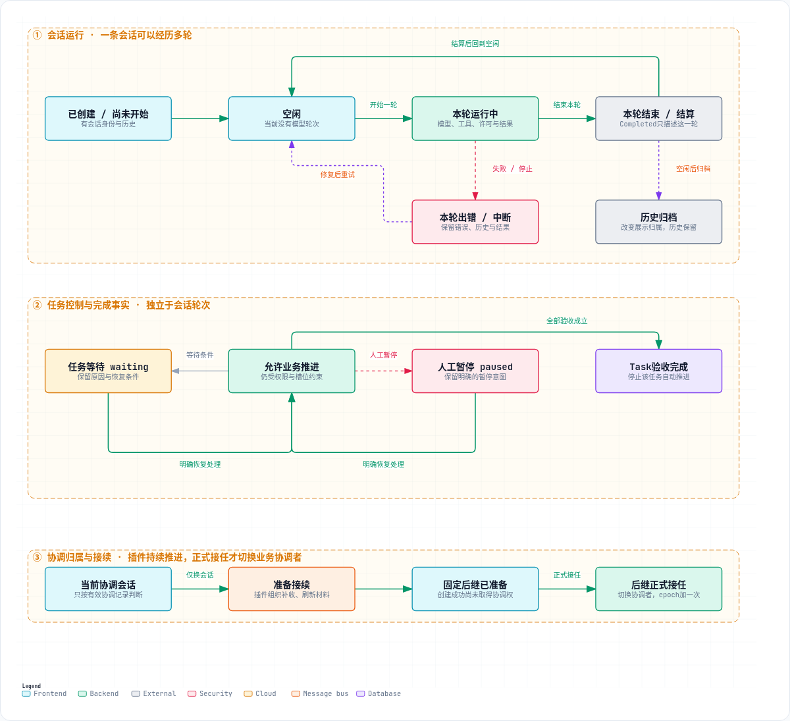

# 会话生命周期与插件持续推进

## 背景

LF指出，旧图把插件、原会话和新会话画成不断交棒的三条泳道，容易让人理解为：每个参与方既执行一步，又必须负责唤醒下一个参与方；任何一方中断，流程就失去负责人。此处明确同一 Task 的持续推进责任与当前业务协调会话的区别。

本说明对应 [#270](https://github.com/a2d2-dev/dsh-plugin/issues/270) 及其原生子票。配图为[会话生命周期](../artifacts/session-lifecycle-2026-10-25/session-lifecycle.html)，执行合同见 [ADR 0011](../adr/0011-explicit-task-runtime-owns-execution-and-recovery.md) 与 [v4执行架构](v4-execution.md)。这是设计及实现合同；运行实例是否满足每个场景，由对应交付与既有GUI验收证据确认。

## 目标

- 插件始终持有同一 Task 接续流程的推进责任；会话执行被明确请求的步骤。
- 中断后能回答正在等谁、缺少什么、从哪一步恢复；固定操作和后继身份保留。
- 会话运行、业务控制、协调归属分别表达；换会话保留等待/暂停、规格和验收。
- 材料保存、后继创建、正式接任、投递、真实可读逐项确认。

### 非目标

不要求三个参与方全程同时健康，不承诺必要材料丢失后仍可成功，不将观察当作结果收取或业务验收，不提供跨会话Goal自动迁移或rearm。后台推进不依赖浏览器常开，也不要求模型不断空推。

## 架构

### 概要设计

插件内部针对同一 Task 维护持久推进循环：**读取进度及真实事实 → 判断当前缺口 → 请求一个允许的步骤 → 核实实际结果 → 保存进度 → 继续、等待或恢复。**

发出请求以后，插件仍负责检查结果及决定下一步。原会话、新会话的轮次结束只提供执行事实，不能代替步骤完成。当前业务协调会话仅在正式接任边界切换，流程的持续推进责任不随之交给会话。

### 组件与状态归属

| 对象 | 职责与保存的事实 | 不可混淆的边界 |
| --- | --- | --- |
| Task | 目标、规格、验收、完成事实 | 换会话仍是同一件工作；不重建Task或缩减验收 |
| TaskExecution | 有效协调关联、owner、epoch、业务控制及恢复事实 | 正式接任切换会话并增一次epoch；保留原等待/暂停控制 |
| Session | 对话、模型与工具轮次、步骤结果和历史 | 空闲或一轮Completed不证明Task完成，也不授予协调权 |
| 接续操作 | 固定operation、source/successor、材料、步骤进度、错误与恢复入口 | 由插件持久管理；请求发出、消费与结果确认分别保存 |
| 宿主能力 | 准确会话的执行、正式工具结果提交、flush和公开观察 | 插件按真实结果推进，不裸读结果制造collected或伪造人类权限 |

业务判断仍由承担相应工作的Agent完成；插件组织步骤、核对权限与事实，不把所有业务判断写死为规则。

### 三个独立维度

| 维度 | 回答的问题 | 示例 |
| --- | --- | --- |
| 会话运行 | 当前是否有模型轮次在执行？ | 尚未开始、运行中、空闲、本轮出错 |
| 业务控制 | 是否获准自动推进工作？ | 允许推进、waiting、paused、失败、验收完成 |
| 协调归属 | 哪条会话现在具有有效协调身份？ | 当前会话、准备中的后继、已接任、历史 |

一条会话可以同时是“空闲、Task waiting、当前协调会话”。另有后台作业是否终态、结果是否正式收取、Task是否验收完成三个独立事实，不从空闲或Completed推断。

### 会话生命周期与操作

[打开生命周期与操作 HTML 图](../artifacts/session-lifecycle-2026-10-25/session-lifecycle-operations.html)。会话运行可以经历多轮；等待、暂停、恢复和Task验收属于任务控制及完成事实；正式接任才切换有效协调会话。仅换会话保留原控制意图，接任后继续分别确认投递与材料可读。

### 数据流程与恢复边界

1. 插件读取持久接续进度、当前TaskExecution和宿主公开执行事实，判断当前步骤。
2. 若有可达终态但输出pending的作业，在维护锁外向准确owner会话请求正式job_output。真实工具结果提交、flush并复查后，才能确认收取。原生子会话的结果还须满足正式父会话接收合同。
3. 插件请求原会话保存材料，绑定Task、execution、source、epoch、规格版本及结果新鲜度。补收产生新事实后刷新材料。
4. 插件准备固定后继。后继存在不代表取得协调权；正式接任才切换当前协调会话、增加一次epoch，并将原会话记为历史关系。
5. 插件向固定后继投递材料，核验正式读取工具的成功结果及持久化回读，才确认真实可读。投递成功与读取确认分别成立。
6. 按原业务控制安排后续：正常控制才继续原next；waiting/paused后继继续保持等待/暂停。受控流程撤销旧Goal activation并回读，不修改Goal持久phase/revision或绕过人类pause/resume权限。
7. 每一步失败或未确认时，保存具体步骤、执行者、已有结果、错误和恢复入口；事件、空闲检查或插件恢复检查再次从持久进度判断。已消费但缺结果不会以相同请求不断空推；修复实际失败后，通过显式重试生成必要的新步骤请求，operation与固定后继保留。

这套循环允许参与方按步骤可用：补收/整理时需要原会话，读取时需要后继；原会话必要结果已经可靠保存后，后续不依赖它继续运行。插件重启后恢复同一个操作。缺少必要材料且无法恢复时如实受阻，推进责任和恢复记录仍在插件。

## 场景

### 接入与查看

**前置条件**：既有 `http://127.0.0.1:3080/` 实例加载经核实的插件包，相关宿主能力可用；Task及当前协调关联已存在。

**操作**：打开任务详情或原生会话的“A²D² 接续”页，查看当前Task、会话运行、控制原因及协调关系。

**状态呈现与数据走向**：持久Task/Execution → 宿主公开观察 → 接续投影 → 页面。查看本身不收取结果、不更换协调者、不恢复业务。普通新建会话不会取得现有Task协调权。

**完成判据**：页面所示会话、owner/epoch及业务控制与权威记录一致；没有因观察产生新的执行或控制变更。

### 等待或暂停时仅换会话

**前置条件**：原会话空闲，Task尚未验收完成，明确意图是仅换会话；保留等待/暂停原因与恢复条件。

**操作**：从受控接续入口明确请求更换会话，使用既有 `task.continue` 合同；页面操作名称与提示由#275交付核验。

**状态呈现与数据走向**：同一Task/Execution → 插件持久接续操作 → 必要步骤 → 固定后继正式接任 → 材料投递与读取确认。Task、规格验收、owner、完整control及槽位资格保留，epoch仅增一次。

**完成判据**：后继真实接任且材料可读，业务仍waiting/paused；页面浏览和普通人工对话不隐式恢复自动调度。“恢复处理”具有独立的明确业务含义。

### 作业完成但结果未收取

**前置条件**：至少两个可达、终态、输出pending的作业，owner可核实；必要原生父子结果也须正式结算。

**操作**：发起接续，由插件发现缺口并组织准确owner补收；无需LF复制工具指令连接阶段。

**状态呈现与数据走向**：公开观察发现pending → 准确owner正式job_output → 成功Session工具结果及flush → 插件复查 → 新材料 → 固定后继。作业执行完成、输出已交付、模型理解及业务验收分别表达。

**完成判据**：真实结果进入准确会话与新材料，随后实际接任、投递和读取确认完成；不以一次host方法调用或按钮可点代替整条链路。

### 步骤中断与插件恢复

**前置条件**：材料请求已消费却未保存，或者正式接任后投递中断；持久操作身份存在。

**操作**：查看具体失败和执行者，修复实际缺口后重试已有操作；插件恢复检查继续读取同一进度。

**状态呈现与数据走向**：失败事实 → 原operation恢复点 → 必要的新步骤请求或补投 → 正式结果回读。接任前不伪造协调权转移；接任后只恢复剩余投递，不重新接任。历史旧协议delivered保留“已投递但无新读取凭据”，不自动重开或伪标received。

**完成判据**：操作与固定后继不重复，epoch不重复增加，真实结果核实后才前进，原业务控制不变。

### 正常继续、任务完成与归档

**操作与状态呈现**：正常控制下，读取确认完成后继续材料中的原next，仍服从权限及持续处理槽位。Task完成以验收事实为准，停止该Task自动推进；会话历史仍可查看与对话。归档改变历史展示归属，不替代验收，不恢复业务或改变有效协调关系。

**完成判据**：正常接续实际执行原next；waiting/paused对照场景没有业务推进；完成和归档没有隐式恢复或重开工作。

## 验证边界

图示及本文作为#270的可见设计主线。后端行为由#274/PR#282及其评审整改验证，页面表达由#275交付，全部原验收和#259/#268原真实模式由#276在既有GUI验证。规格图的浏览器截图只证明图可读，不是产品接任验收。所有原十项验收保留，父票未完成前不记Done。
