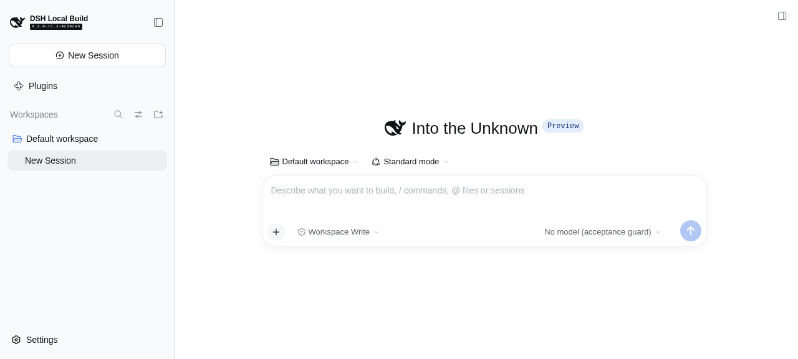

# #121 验收工具阶段证据（2026-10-19）

本阶段目的：为最终产品包准备真实隔离 DSH Web 启动、模型双层 guard 与 Session 基线能力。**只完成 host-only 环境及 guard 验证；#121 产品浏览器验收未验证。** 未装载 A²D² 产品包，插件 SHA 为 null；无产品 mock／fallback。

## 实际基线

| 对象 | 实际记录 |
| --- | --- |
| 验收分支起点 | `e9dc56bdc022cfdfa259bc5f1e04b931249bb102` |
| 分支 | `feat/a2d2-v3-01-browser-acceptance` |
| 宿主源码 | `a45068d2ec03326c800c68c9bdcd47508e3ccb9c` |
| CLI／Node | `0.2.0-rc.2`／`v22.23.1` |
| 浏览器实际前端版本 | `0.2.0-rc.2-4c24ce4`；已有构建非全同代，未改宿主 |
| 正控进程 | PID `3106460`，managed job `bash-369`，`http://127.0.0.1:44021` |
| 正控后新零调用进程 | PID `3113163`，managed job `bash-381`，`http://127.0.0.1:46803` |
| 唯一实际 provider | `acceptance-disabled`，默认模型 `no-model` |
| 正式基线 Session ID 集合 | `{session-ac81293e-fe83-4562-adcb-ff0bb15c645a}` |
| cwd | `/tmp/a2d2-v3-121/host-zero-final/workspace/deepseek-harness/default-workspace` |
| 权限 | sandbox `workspace-write`，approval `ask` |
| 正式计数 | gateway `0`、adapter `0`；首次 UI restore 创建真实 Session `1` 次，冻结后未增加 |

## 步骤与记录

1. 第一条命令校验指定 worktree 的 pwd 与 branch，完全匹配；git HEAD 为指定 base，初始工作树干净。
2. 先运行工具行为红灯，最小实现后绿灯；覆盖凭据环境不继承、目录约束、Session ID 置换（数量相同也拒绝）、cwd 配置变化、双层调用、额外出生，以及重启已知 Session 重装载与未知 Session 出生。
3. 真实启动第一次失败：guard 位于产品仓库内，宿主根据最近 package 元数据尝试装配不存在的产品客户端 bundle。启动工具明确报 `Host exited without Web readiness; zero-call acceptance invalid`。修复为 `/tmp` 下独立无 dsh.client 声明的 guard 包。另已核验 LLM 的真实解析锚点应为 base bundle，controller／客户端锚点为 web-app bundle。
4. 最终 guard 正控使用真实宿主公开 LLM stream（空 messages、无 Session prompt）：[正控记录](positive/positive.json) 显示 gateway `0→1`、adapter `0→1`、唯一 finish `error`、固定抛错标记 `A2D2_ACCEPTANCE_MODEL_DISABLED`；未生成模型文本。
5. 正控终止后新建真实 CLI 进程；保留零调用 root 内既有 guard-start 记录，不删除或清零 metrics。使用独立 agent-browser session/profile 登录，完成 Preview Notice，snapshot 确认原生 Workspace／Session／输入框／模型选择。人工读取 [真实宿主截图](zero/host-ready.png) 确认是完整可用页面。
6. [基线](zero/baseline.json) 及 [检查](zero/1792427260921-check.json) 通过公开 Session controller 与公开配置服务获得，集合与配置未变，双计数为零。配置投影 `lastUsed`／`next` 为 null（未发 prompt），同时冻结实际公开默认路由 `acceptance-disabled/no-model`。
7. 清理所有本票启动的 Web managed jobs 和本票 agent-browser。独立 home/profile/workspace/log/evidence 留在 `/tmp/a2d2-v3-121/` 供复核；未删除任何宿主或原用户数据。

## 命令退出码

| 命令／动作 | 退出码及结论 |
| --- | --- |
| pwd、git branch／HEAD／status | 0；目录分支与基线匹配 |
| `agent-browser skills get core` | 0；按实际安装版本加载 |
| Node 行为测试首次、基线漂移首次、prepare 导出首次、重启行为首次 | 各 1；分别观察到缺模块／缺异常／缺导出／错误拒绝已知重载的红灯 |
| 修正后的 Node 默认测试 | 0；3 pass，2 个真实宿主测试按未提供环境变量跳过 |
| 真实正控测试（设置 A2D2_ACCEPTANCE_POSITIVE_ROOT） | 0；4 pass，zero 场景单独运行故 1 skip |
| 真实零调用测试（设置 A2D2_ACCEPTANCE_ZERO_ROOT） | 0；[TAP 记录](zero/zero-tests.tap)，4 pass，positive 场景单独运行故 1 skip |
| 首次 prepare 解析 LLM | 1；web-app 不直接依赖 llm，改为已核验 base 锚点 |
| 首次真实 Web job `bash-319` | 1；客户端包归属错误被显式拒绝，未当作通过 |
| 最终 prepare／job 登记／baseline／check | 各 0；真实页面与配置证据齐备 |
| agent-browser open／snapshot／Continue／wait／screenshot／close | 各 0；专属 session/profile，无 auto-connect／CDP |
| 证据归档第一次 | Node 命令 1（误用 cpFile 导出）；修正原生 copyFile 后 0，未修改产品代码 |

重放真实测试应使用新环境。正控必须恰好一次，不应在已为 1/1 的 root 重复 positive。命令详见 [工具文档](../../architecture/a2d2-v3-121-acceptance.md)。

## Managed jobs 与资源清理

| Web job | 结果及用途 |
| --- | --- |
| `bash-319` | 启动失败 exit 1，已结束 |
| `bash-325` | 初步正控成功，主动停止，子进程 exit 0 |
| `bash-347` | 初步真实浏览器零调用，主动停止，子进程 exit 0 |
| `bash-369` | 最终正控，主动停止， [exit 0](positive/ac86b242-b625-428a-bb9a-48d3dcae9173-exit.json) |
| `bash-370` | 预备零调用进程，正控后重新起新进程以遵循先后次序，主动停止 exit 0 |
| `bash-381` | 正控后新进程最终页面／基线，主动停止，[exit 0](zero/c10a6f41-bbb5-41af-b26e-6276e8bac94c-exit.json) |

短时 CLI／浏览器 jobs `bash-289`、`bash-350`、`bash-383`、`bash-387` 均已收集，exit 0。所有实例均使用 OS 动态端口，未部署、重启或接管 18780／18781。

## 文件与可复核边界

[正控 manifest](positive/manifest.json)、[正控 run](positive/current-run.json)、[正控 metrics](positive/metrics.jsonl)、[零调用 manifest](zero/manifest.json)、[零调用 run](zero/current-run.json)、[零调用 metrics](zero/metrics.jsonl) 和 [工具 SHA256](tool-sha256.json) 为脱敏白名单记录。不包含登录 token、原始服务日志、browser profile 或模型正文。

待 CEO 最终整合 tgz 后再验证：官方插件安装分支、完整 A²D² 本地 Project／Task／四标签／拆解／关联／来回导航／返回位置／刷新重启及公开工作查询。`seed` 公开 controller 工具实现已准备，本阶段未额外运行以避免扩展 host-only 场景；产品重启及原生已有会话导航后的持久配置比较仍待真实产品流程验证。
