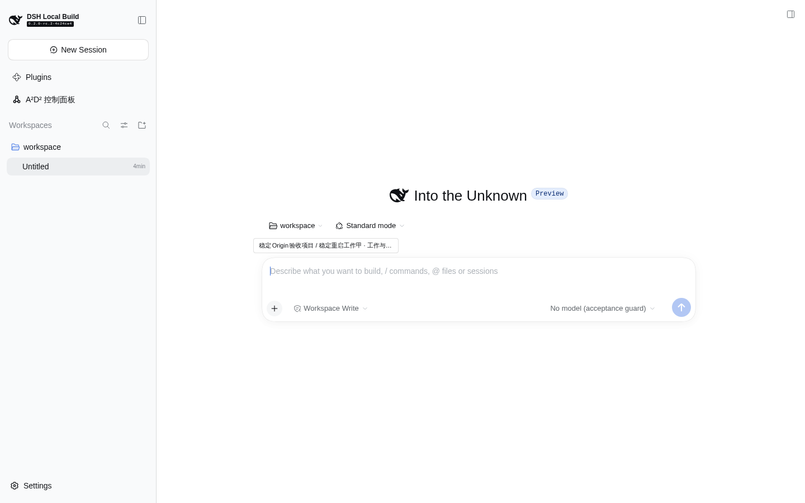

# R6 稳定 Origin 最后验收 gate

**结论：通过。** 同一真实产品包、同一隔离 profile／browser-profile、同一实际 baseURL，经不同真实进程重启后，完整公开领域查询、两个精确 Session ID、实际 cwd／模型／权限全部不变，跨进程 append-only 的 gateway／adapter 计数均为 0。剩余 cold Session 只通过真实工作轻入口与 Task“打开会话”恢复，没有新建／删除 Session、直接写 selection、伪造 store 或重定基线。

这轮仅补最后稳定 Origin gate；同一包此前已通过的完整 UI、原文三路径、R5 当前同 Session 新关联即时入口、HTTP、刷新等证据见 [产品最终总裁决](../README.md)。旧 [动态 Origin 失败尝试](../attempt-dynamic-origin/README.md) 与首轮失败保持原样，不追改成通过。

## 固定身份与指纹

| 对象 | 实际事实 |
| --- | --- |
| 验收工具冻结提交 | `56679a69286f473d786735576c81ffa3a61d4238` |
| 产品代码修复提交 | `433e9860ca76026a05d001c0552da0a4b45c84bf` |
| 同一产品 tgz SHA256 | `81466a33342c0256873bbf30dac693ee0cff2c075246a4ad859d94663ce0a82b` |
| 宿主源码 HEAD | `a45068d2ec03326c800c68c9bdcd47508e3ccb9c` |
| CLI／Node | `0.2.0-rc.2`／`v22.23.1` |
| 实际宿主前端 | `0.2.0-rc.2-4c24ce4`，没有擅自重建既有宿主 |
| acceptance.mjs SHA256 | `a3f1457e87949ef51345edc820028a9e19c21f2b3b39e82284ccfbf2d79419f8` |
| guard.mjs SHA256 | `442573774fd2c16eb858af534230cbfb8f7029ff8d483085926b14531454e62d` |
| CLI bin.js SHA256 | `1a03dee18683483ff6a1b27b2a1e650230da6bcca9a0f55f7d81b3308c3f307f` |
| fresh root | `/tmp/a2d2-v3-121/product-stable-origin-56679a6`；启动前不存在，`/tmp` 与本票根 lstat 均为非 symlink 目录 |
| browser | 专属 agent-browser session `a2d2-v3-121`，本 root 内 browser-profile，1440×900；无 auto-connect／CDP |

[完整工具／包／宿主指纹](08-fixed-tool-package-host-hashes.json) 还记录了实际 llm、Session／Workspace controller、client-modules 构建指纹。[manifest](manifest.json) 记录官方真实安装的 tgz 绝对路径与实测 SHA。guard 与 [已通过真实正控的同一内容](../positive-guard/positive.json) SHA 完全相同，因此不重复调用正控或污染正式零调用指标。

## 两次真实进程

| 字段 | 首次启动 | 同 root 重启 |
| --- | --- | --- |
| managed job | `bash-632` | `bash-639` |
| 实际 baseURL | `http://127.0.0.1:39683` | `http://127.0.0.1:39683` |
| runId | `9ae7a866-f098-4fd8-9233-03a8cb2dd242` | `a4b3ad40-bc0f-468f-b532-fe171ae6757d` |
| 子进程 PID | `3441526` | `3454422` |
| 实际退出 | [code 0](9ae7a866-f098-4fd8-9233-03a8cb2dd242-exit.json) | [code 0](a4b3ad40-bc0f-468f-b532-fe171ae6757d-exit.json) |

首次由工具以 port 0 分配真实空闲端口；重启直接使用同一个 `run --root`，工具复用已记录的 39683。确实观察到新 managed job 的新 ready 输出、runId 与 PID 后，才核对并登记 job，未以旧 current-run 存在作为 ready。[09 新 ready 断言](09-new-ready-same-origin.json) 和两份 [首次 run](9ae7a866-f098-4fd8-9233-03a8cb2dd242-run.json)／[重启 run](a4b3ad40-bc0f-468f-b532-fe171ae6757d-run.json) 可独立核查。

## 操作与结果

1. 先校验独占 worktree／分支／干净状态，从 `d434332` 仅执行授权的 `merge --ff-only` 到固定 R6 HEAD；校验同一 tgz SHA，官方 `prepare` 安装到新 root，首次 `run` managed 启动。
2. 冻结前用修复 seed 建立两个无 prompt 的真实 Session，公开 Workspace create 的幂等读取返回 `created:false`，两个非空 workspaceId、cwd 及真实成员关系一致。[03 seed 实证](03-seed-membership-verified.json) 通过。
3. 仅通过生产公开工作命令准备 1 个代表性 Project／默认 ProjectAgent、2 个父子 Task，包含拆解、规格历史、多行独立验收及两条真实 Session 关联。没有直接写 Task store。[04 公开命令与结果](04-public-representative-work-created.json) 完整保存。
4. 浏览器使用真实 Task 轻入口 → 子工作详情 → 会话标签 → “打开会话”，显式选择原有乙 Session，使浏览器合法选择自然持久化；没有读写 localStorage。[05 首进程原生截图](05-native-selected-before-restart.png) 确认原生输入框、禁用模型与工作入口。
5. 保存 [完整首进程公开域／ID／实际配置基线](07-complete-state-before-restart.json)；停止首 job 并收集 code 0。未手工删改 current-run、baseline 或 metrics。再次原样 `run --root`，实际 Origin 完全相同，runId／PID 均不同。
6. 首先只读公开完整 ID 和领域查询。两 ID 精确不变，完整 Project／Agent／Task、历史、父子、拆解与关联逐字段相同。[10 重启公开结果](10-restart-id-set-and-complete-domain.json) 通过。
7. 保留的同 profile 浏览器会自动重连并原生恢复已选乙 Session；观测到 1 个可用 Agent、甲 Session 冷态。这是 `agentAvailable` 事实，不是 SessionStore 对象数量。随后交换新 private token，走乙工作轻入口 → 相关父工作 → 会话 → “打开会话”，仅以原生导航恢复原有冷态甲 Session。
8. [12 严格配置 check](12-strict-config-check-after-native-restore.json) 退出 0，`unchanged:true`；[13 总 gate](13-stable-origin-gate-passed.json) 全部断言退出 0：同 Origin、新进程、精确 ID、实际配置和完整公开领域查询相等，gateway=0、adapter=0。
9. 停止并收集重启 job code 0，关闭专属 browser；保存 append-only 指标和全部临时数据，不删除或重置旧失败 root。

## 精确 Session 基线与生命周期

精确集合始终为：

- `session-dfa13dc0-f8e2-4aae-b4bf-6a163f40b4bd`
- `session-3b94b9cf-c18c-496e-a313-a37e2c3f65a0`

两 Session 的 cwd 均为本 root 的 `workspace`，默认 `acceptance-disabled/no-model`，sandbox `workspace-write`、approval `ask`；未发 prompt，模型使用投影保持 `lastUsed:null`、`next:null`。重启后比较的是恢复后的实际 live 配置，没有用 cold 空对象代替。

[完整 metrics](metrics.jsonl) 保留两个 processId：首次两个 `session-born`，重启恢复两个相同身份再次产生 `session-born`，累计 births=4、不同 Session ID 仍为 2。该恢复事实完整记录，未清零；没有第三身份。gateway 和 adapter 在两进程累计均为 **0**。

## 退出码与覆盖边界

- package／fresh root 校验、官方安装、seed 成员断言、代表性工作命令、原生导航、baseline、新 ready／同 Origin／不同 PID 断言、公开完整域／ID比较、严格配置 check、最终 gate：均 exit 0。
- [额外诊断](14-extra-agent-availability-diagnostic.json) 曾错误要求同 Origin 保留浏览器自动重连前的可用 Agent 数必须为 0，实际为 1，断言 exit 1；当次 ID／域比较已经通过。该假设不是 AC，按真实结果保留解释，不伪造为通过，也不计为产品失败；未重启或人为制造 0 Agent 状态来迎合。
- CEO 在同固定 R6 工具源码验证 28 项通过、2 个真实宿主项默认未选（exit 0）；本 lane 不重复安装缺失依赖或把未选用例计为真实通过，真实 guard 与本 gate 另有运行证据。
- 短 jobs `bash-631`（安装）、`bash-633`（seed／公开准备）、`bash-634`（首次登录）、`bash-637`（原生选择／baseline）、`bash-643`（原生恢复／严格 check）均已收集 exit 0；两个 Web jobs 均由本轮管理并已停止收集。
- 本轮未重新覆盖全部产品 UI；同一产品包的 R1／R5／HTTP／刷新等通过证据有效并由总裁决逐项引用。没有未通过的剩余验收 gate。
- 正式证据只白名单复制 JSON／JSONL／PNG 和 manifest，不包含登录 URL、cookie、原始服务日志、browser profile 或编译产物。没有操作 18780／18781、宿主、其他 checkout 或现有用户 profile，没有合并 PR 或关闭外部 Issue。
