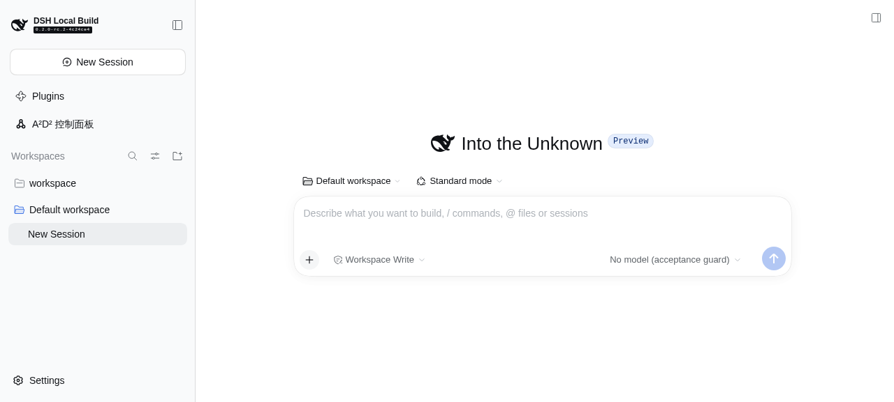

# #121 产品首轮真实验收：9588b53

**结论：不通过，等待修复包与修复后的验收工具在 fresh root 全量复验。** 本轮确认了两个产品问题，并保留了一项受 seed 工具缺陷影响的重启 Session 严格基线失败。工作领域数据的刷新／进程重启一致性独立通过。没有修改产品或工具源码，没有用 mock、fallback、发 prompt 或删除会话来补齐验收。

## 目的与固定基线

目的：把前一阶段真实宿主隔离能力用于指定整合插件包，检查本地 Project／Task、规格、拆解、关联、原生导航、HTTP 权限与持久性。原有 [host-only 阶段证据](../README.md) 不被覆盖；本目录仅记录这次产品首轮。

| 对象 | 实际事实 |
| --- | --- |
| 验收 worktree／分支 | `a2d2-v3-01-browser-acceptance`／`feat/a2d2-v3-01-browser-acceptance`，启动前 HEAD `72b62006f0737e5f3da04257818edd7bb9ad9b74`，干净 |
| 工具固定提交 | `72b62006f0737e5f3da04257818edd7bb9ad9b74`；未取用并行整改中的工具 |
| CEO 指定产品提交 | `9588b5347595b4adc045a747271284912ea0088a` |
| 指定 tgz | `/tmp/a2d2-v3-121/artifacts/integration-9588b53/dsh-a2d2-0.0.1.tgz` |
| 实测 tgz SHA256 | `eb2d89ed65c1addb06cceb8e6abe5130249bd2ae9bb3ace2e95bd4d574f426e0`，与指定值完全一致 |
| 宿主源码／CLI／Node | `a45068d2ec03326c800c68c9bdcd47508e3ccb9c`／`0.2.0-rc.2`／`v22.23.1` |
| 实际前端版本 | `0.2.0-rc.2-4c24ce4`；现有构建非全同代，未改宿主 |
| fresh root | `/tmp/a2d2-v3-121/product-first-pass-9588b53` |
| 启动前路径检查 | `/tmp`、`/tmp/a2d2-v3-121` 均 lstat 为目录且非 symlink；新 root 原先不存在，无 symlink 祖先 |
| 首次产品 Web | managed job `bash-428`，PID `3152484`，`http://127.0.0.1:40457` |
| 同 root 真重启 | managed job `bash-500`，PID `3211752`，`http://127.0.0.1:45791` |
| 独立浏览器 | agent-browser session `a2d2-v3-121`，本 fresh root 内 browser-profile；无 auto-connect／CDP |
| 实际唯一 provider | `acceptance-disabled`，默认模型 `no-model` |
| 产品运行身份 | runtimeId `e0bfdec6-2f39-4435-b28b-26c3f425be3a`，重启不变 |

[安装与宿主 manifest](manifest.json)、[首进程 run](94022ba5-c6e8-4ac4-8aea-64be87da165d-run.json)、[重启 run](4f10bfa1-ecf5-4266-a5e4-59973e4de0de-run.json) 均无登录凭据。官方 CLI `plugin --profile web add` 安装成功，然后真实 `dsh web` ready；没有独立 Vite／HTML 外壳。

## 真实步骤与规格结果

| 场景 | 结果 | 主要证据 |
| --- | --- | --- |
| 原生 DSH／唯一控制面板入口／无 Project 创建入口 | 通过；侧栏、Workspace、Session、输入框保留。无 Project 时显示接入／创建，未提供“所有项目”选项 | [初始原生页面](00-native-before-panel.png)、[无 Project 页面](01-empty-project.png) |
| 两个本地 Project 同名 Task | 通过；甲关联默认 Workspace，乙独立无资源；没有 GitHub 账号、remote 或 Issue 操作。两 Task 名称相同而身份、目标与规格独立 | [创建原文公开查询](06-ui-created-original-comparison.json)、[刷新前完整领域查询](33-persistence-before-reload.json) |
| 完整目标／规格／验收原文创建及 UI 更新 | **失败 F1**；首尾空白／尾换行丢失，多行单条验收结构被拆散 | [创建比较](06-ui-created-original-comparison.json)、[API 合法原文](07-api-multiline-criteria.json)、[UI 往返比较](11-ui-roundtrip-original-comparison.json) |
| 四详情标签、拆解与独立子 Task | 通过；概览／会话／相关工作／活动均实际进入；保存拆解块，创建子工作，子详情可返回正确父 Task；活动显示版本 1–6 | [拆解](14-breakdown-saved.png)、[子工作父引用](15-child-parent-link.png)、[活动版本](17-activity-command-versions.png)、[公开父子记录](24-after-duplicate-association.json) |
| 仅当前 Project 内容 | 通过；乙项目搜索甲子工作无结果；切甲后只列甲父子工作；同名乙工作不混入 | [乙过滤](18-project-b-no-cross-project-child.png)、[甲筛选](19-project-a-filter-before-detail.png) |
| 已有兼容 Session 关联、重复幂等、真实宿主导航 | 通过；候选只有真实默认 Workspace 的已有 Session；重复 UI 关联后完整 Task 对象相等、版本始终 6、关联数为 1；“打开会话”回到真实原生 Session | [候选](21-real-session-candidates.png)、[幂等前](23-before-duplicate-association.json)、[幂等后](24-after-duplicate-association.json)、[汇总](49-summary.json) |
| 原生轻量工作入口返回正确四标签详情 | **失败 F2**；关联公开查询有记录，但空原生会话中按钮数量为 0。没有把侧栏入口替代这条路径宣称通过 | [查询与按钮计数](27-session-work-query-native-entry-missing.json)、[稳定缺失截图](28-native-work-entry-missing-stable.png) |
| 返回列表保留 Project／视图／筛选 | 通过；保留甲、项目视图、“尚未关联会话”及搜索“同名验收”。父 Task 已关联后被该筛选排除，空列表符合条件 | [返回列表截图](29-return-list-filter-preserved.png) |
| 关闭面板回原会话 | 通过；返回默认 Workspace 中原来那个已有 Session 的输入框和禁用模型选择 | [关闭结果](30-close-panel-native-session.png)、[严格 check](31-check-after-close.json) |
| 刷新后公开工作查询一致、Session 配置不变 | 通过；完整 projects.list + 全部 project.detail 逐字段相同；所有身份、历史、拆解及关联保留 | [刷新比较](38-persistence-after-refresh.json)、[刷新 check](37-check-after-refresh.json) |
| 真实进程重启后工作领域查询一致 | 通过；2 Project、2 ProjectAgent、3 Task 与 runtimeId 不变，完整结果逐字段相同 | [真实重启比较](40-persistence-after-restart.json)、[重启 UI](45-panel-after-restart.png) |
| 真实进程重启 Session ID 集合／配置严格不变 | **失败 F3，受旧 seed 工具缺陷影响**；2 IDs 变 3 IDs，原 2 个为 cold，guard 拒绝缺失 live 配置投影。保留污染，不删会话、不重定基线 | [有效公开 Session RPC](43-valid-public-sessions-after-restart.json)、[集合比较失败](44-restart-session-comparison-failed.json)、[cold 错误](48-restart-cold-guard-error.json)、[缺挂关系](46-public-workspace-seed-membership.json) |
| 所有阶段真实模型调用 | 通过；两个进程的 append-only metrics 合并 gateway=0、adapter=0，未发 prompt；重启计数文件完整保留 | [完整 metrics](metrics.jsonl)、[重启比较](44-restart-session-comparison-failed.json) |
| 旧 writer／唯一旧地址映射契约 | 本轮未独立复验；由后端 lane 提供自动行为证据，不将其折算为本轮浏览器通过 | 待最终交付复核 |

本轮没有单独构造“宿主不存在任何 live Session”的产品场景；实际使用真实无 prompt 的 Session，不能把 idle 会话等同于零 live 会话。

## F1：原文和验收条目边界丢失

1. 真实 UI 创建同名父工作，目标输入 `"  目标甲第一行\n    缩进目标第二行\n"`，规格输入 `"  规格甲第一行\n    缩进规格第二行\n"`。
2. 公开 task.detail 证明创建后首尾空白／尾换行已丢失，`goalPreserved=false`、`specificationPreserved=false`。
3. 再通过真实 `POST /a2d2/api/work` 的 `task.update-spec` 保存合法完整原文及两条验收：第一条 `"  单条验收第一行\n    同一条第二行\n"`，第二条 `"第二条独立验收\n"`。后端完整保存，版本由 1 到 2。
4. UI 刷新 → 更新规格 → 不编辑直接保存。目标／规格再被 trim；原两条验收变为 `["单条验收第一行", "同一条第二行", "第二条独立验收"]`，版本变 3。

[输入截图](05-task-original-input.png)、[API 原文概览](09-api-original-overview.png)、[编辑前截图](10-multiline-edit-before-save.png) 与上述公开查询共同构成真实证据。没有通过直接写 store 植入数据。

## F2：合法空会话的原生工作入口缺失

Task 关联的真实 Session 为 `session-2dd5b1d5-8de1-400b-aa85-cd421d607c8d`。正确 runtimeId 的 session.work 查询明确返回甲项目父 Task；UI“打开会话”真实导航成功，原生页面稳定后 title 为“查看工作与进展”的按钮仍为 0。

只读定位：指定安装包的客户端把 SessionWorkEntry 挂在 `conversation.session.header.actions`；真实宿主的 ConversationSessionHeader 在 `hideChrome=true` 的 blank Session 下不渲染该 actions 插槽，corner 插槽则仍存在。未修改宿主或产品以绕开；未发送 prompt 来制造非空会话。已把此根因交给 CEO 与整改 lane。

## F3：seed 缺挂与重启严格 Session 基线失败

冻结基线前，公开 controller seed 创建了第二个真实 Session。旧 guard 读取 `created.workspace.id`，但公开 WorkspaceCreateValue 的身份字段是 `workspace.workspaceId`。因此传给 Session create 的 workspaceId 为 undefined，真实 Session 按默认 cwd 创建，未挂到其刚建立的 Workspace。返回结果只有 sessionId 与 agentPreset，缺 workspaceId。[阶段事实](47-stage-facts.json) 记录了实际工具返回和固定工具提交。

[原基线](baseline.json) 的 Session ID 集合为：

- `session-2dd5b1d5-8de1-400b-aa85-cd421d607c8d`，cwd 为隔离 default-workspace。
- `session-78e1dde5-602a-41fe-a7f5-8ef15cf406ab`，cwd 为隔离 workspace 根。

两个 Session 都采用 `acceptance-disabled/no-model` 默认路由、`workspace-write` 和 `ask`。首进程的 10 次成功 check 产生 19 份快照／CLI 输出记录，逐字段配置均等于该基线，双计数均为 0；[汇总](49-summary.json) 保留了每份记录的比较。

同 root 重启后使用新动态端口登录，原生 restoreSelection 选择到 seed 创建却没有该 Session 成员的 Workspace，于是自动创建 `session-5e7342f8-f5be-42c4-9b8b-3207c2853c23`。原 2 个 ID 仍存在但为 cold。公开幂等 Workspace create 仅解析已存在的目录，返回 `created:false`，成员只有新增 Session，`seededSessionAttached:false`，没有修补成员关系。

严格 check 退出 1：`Missing public configuration projections for Session session-78e1dde5-602a-41fe-a7f5-8ef15cf406ab`。后续有效 Typert RPC 确认 3 IDs，明确判定 `sessionSetUnchanged=false`。不把领域数据重启一致性与 Session 集合不增混为一项通过。

[39 号](39-public-sessions-before-restart.json) 和 [41 号](41-public-sessions-after-restart.json) 是最初使用错误 RPC 封装的诊断记录，服务端以 `gateway/bad-request` 拒绝；虽然载体 HTTP 为 200，**它们不是 Session 业务列表或成功证据**。集合判断依据 [guard 基线](baseline.json) 和 [43 号有效 RPC](43-valid-public-sessions-after-restart.json)。

## HTTP 权限与并发边界

[真实鉴权](02-http-auth.json)、[领域拒绝](32-http-domain-boundaries.json)、[合法旧版本冲突](35-http-stale-positive-version.json) 均走真实生产端点。

| 请求 | 实际 HTTP／领域结果 |
| --- | --- |
| 无登录 cookie，payload 伪造 actor.operator=true | 401，`unauthenticated` |
| 有效登录 cookie，但恶意 Origin | 403，`untrusted` |
| TaskId 与 ProjectId 不匹配 | 400，`unknown-task` |
| 跨 Project 父子链接 | 400，`cross-project-reference` |
| 乙独立项目关联甲资源的 Session | 400，`incompatible-session` |
| 正整数旧 expectedVersion=5，实际 currentVersion=6 | 409，`version-conflict` |
| expectedVersion=0 | 400，`invalid-request`；这是 schema 拒绝，不作为版本冲突证据 |
| 缺 commandId | 400，`invalid-request` |
| 同 commandId 换 payload | 409，`command-id-reused` |

全部拒绝前后的公开工作查询逐字段相同；没有创建“不应创建”的记录。仅验证了上述版本／身份冲突，没有把它宣称为并发压力测试。

## 命令退出码、异常与清理

| 操作 | 退出码／实际结果 |
| --- | --- |
| pwd／branch／HEAD／status、祖先 lstat、新 root 不存在与 SHA 校验 | 0 |
| 官方插件 prepare 安装 | 0，短 job `bash-425` |
| 首次产品 Web `bash-428` | ready；阶段结束停止后子进程 exit 0 |
| 真实浏览器登录、Continue、表单输入、滚动、保存、四标签、关联、导航、返回、关闭、刷新、截图 | 正常操作均 exit 0；长批次短 jobs `bash-429`、`bash-431`、`bash-443`、`bash-458`、`bash-467`、`bash-480`、`bash-497` 全部已收集 exit 0 |
| 初次保存项目后的 wait `bash-436` | 1，30 秒超时；随后实际检查表单有效且无提交，显式 scrollintoview 后真实点击正常保存。按长表单视口操作诊断，不列作产品失败 |
| 首进程 baseline 和 10 次 check | 全部 0；重启前 Session 集合／配置与双计数不变 |
| 公开 API 原文比较／拒绝路径／刷新与重启工作数据比较命令 | 0；命令成功记录了产品失败事实，不等于全部 AC 通过 |
| 重启 Web `bash-500` | ready；收口停止后子进程 exit 0 |
| 新 token 登录短 job `bash-502` | 已收集 exit 0 |
| 重启后严格 Session check | **1**，cold public configuration 缺失；有效 RPC 又证明多出 1 个 Session |
| 浏览器 close、证据白名单归档及逐字段汇总 | 0 |

[首进程退出](94022ba5-c6e8-4ac4-8aea-64be87da165d-exit.json)、[重启进程退出](4f10bfa1-ecf5-4266-a5e4-59973e4de0de-exit.json) 均记录 code 0。产品 Web `bash-428`／`bash-500` 与专属 agent-browser 全部停止。隔离 home/profile/workspace/browser/log/evidence 完整保留，不删除或重置污染数据。没有操作 18780／18781、宿主配置、其他用户 profile、真实模型或外部 GitHub 产品写入。

一次交互诊断 network 列表曾在工具输出中带出本隔离首进程登录 URL；未复制进证据或报告，未向外部发送。首进程停止已使该 token 失效；之后仅使用脱敏 HTTP 结果。两次登录 URL、cookie、原始服务日志及 browser profile 均不入 Git。归档前逐个文本文件扫描凭据模式，未发现凭据；正式图片未包含地址栏 token。

## 后续

本次 commit 仅新增本目录证据。等待 CEO 指定修复后的工具提交与 tgz SHA，再在新 fresh root 复验全部 AC，尤其 F1 原文／条目边界、F2 空会话原生轻量入口、F3 正确 seed 和严格刷新／重启 Session 不增。此目录保留失败结论，不用后续结果覆盖首轮事实。
