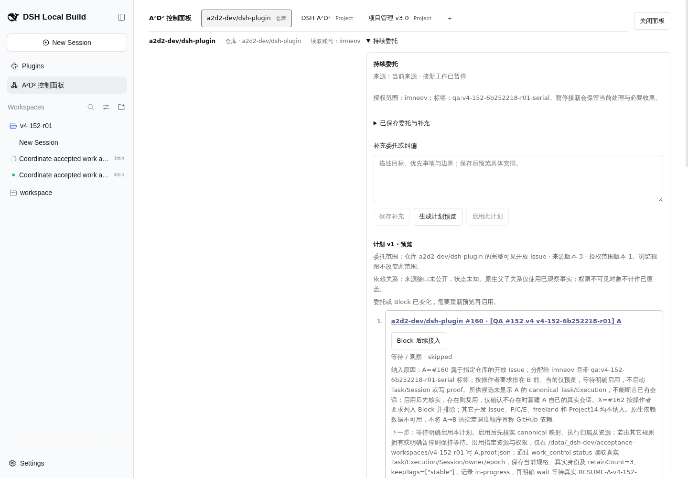
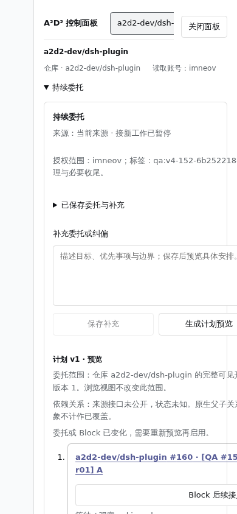
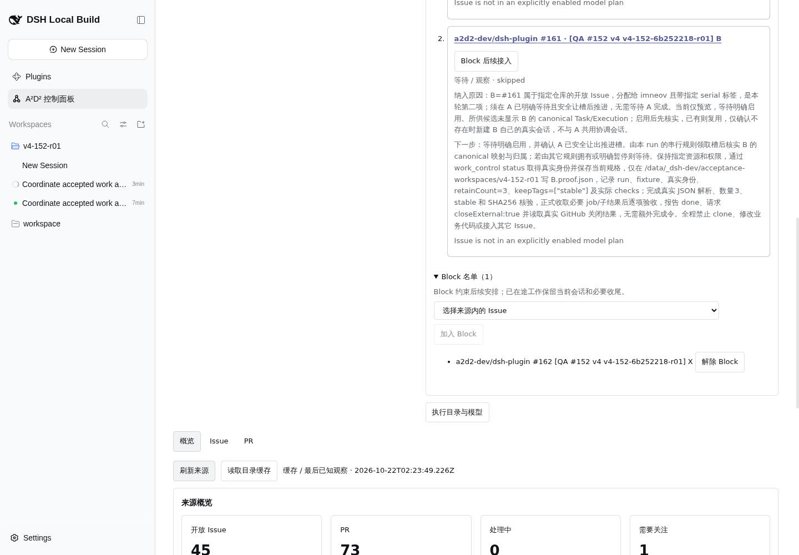

# #152 持续委托第二轮真实验收

## 目的与结论

本轮仅在 preview http://10.126.126.12:18782/ 执行，run 为 `v4-152-6b252218-r01`，对象为 A=#160、B=#161、X=#162。使用 agent-browser 技能及单标签会话 qa152g。未修改插件、Host、profile、业务代码、Issue 正文或 P/C/E；未重启服务。

**部分完成，未通过全部验收。** 已保存自然语言委托、取得真实模型生成的 A→B 计划 v1、成功持久 Block X，并完成补充纠偏。纠偏后一次预览被 `planning-basis-changed` 拒绝，两次预览报 `planning-model-failed`，因此没有当前草稿对应的可执行计划，**没有启用规则**。A/B 未启动，B 未关闭，A 未收到继续令，不能把后续串行和收尾记为通过。

## 完成与未完成

| 要求 | 结果 | 可核验证据 |
|---|---|---|
| 自然语言保存及真实模型预览 | 已完成首次预览 | HTTP200，68.369秒，有序 A→B；why/nextAction/模式完整见 ledger raw |
| 有序 steps、X 排除 | 首份计划已验证 | A 在前、B 在后；两步 mode=wait；X 未进入 steps |
| 预览零执行 | Task/proof 已验证；Session 对重试窗口已验证 | Task 6→6，无 A/B/X；proof 无新增；重试前后 Session 7→7、ID 完全相同。首份预览前正式 Session RPC 未取得，此处不补造差分 |
| X 持久 Block | 已完成 | v5 写入 X；v6 纠偏后读回 X；最终 X item blocked、attempts=0 |
| 补充后重新预览 | 已真实执行，但未生成成功 | 一次 basis changed，两次 model failed；没有新 plan v2 |
| 模型越界 node 被服务端拒绝 | 未验证 | 未实际产生越界模型 steps；不能把自然语言排除或 skipped 状态当此项通过 |
| 启用、串行让槽 | 未完成 | enabled=false；A/B skipped、attempts=0，无 Task/Session/Execution |
| B proof、验收及真实关闭 | 未完成 | B 仍 OPEN，无 CompletionOp、关闭回执或 B proof |
| A 真实恢复与完成 | 未完成 | 未启动；未发送 RESUME-A，不伪造继续输入 |
| 暂停只停后续接入、不终止在途 | 未验证 | 本轮无在途动作；页面提示不是行为证据 |
| 双尺寸截图、中文证据及原始请求/响应 | 已完成 | 本报告、ledger 与 cont2 截图；窄屏裁切缺陷另记 |

## 身份与最终持久状态

| 字段 | 值 |
|---|---|
| projectId | ec480d94-c5e8-44a0-80a0-897945df1a67 |
| sourceId | 9cea4378-0219-4f99-a237-80f51bd36291（仓库 a2d2-dev/dsh-plugin） |
| ruleId | 373d1174-fcb6-49e9-aed0-2ebdb98281aa |
| 最终 rule / draft / scope | v6 / draftVersion=4 / scopeVersion=1 |
| enabled / active | false / 无 |
| plans | 仅 plan v1，draftVersion=2，createdAt=2026-10-22T03:43:41.225Z；已过期，不能启用 |
| Block | [I_kwDOUmfSE88AAAABY_H6TA]（X #162） |
| 硬范围 | assignee=@me，身份 imneov / MDQ6VXNlcjMxNjEyMDMz；必须含 qa:v4-152-6b252218-r01-serial |
| 执行资源 | runtime c01a3a7b-6deb-4820-9896-548d14220162；workspace b2c6edcf-bb21-4925-8ccd-6b0e503de5dc |
| 执行目录 | /data/_dsh-dev/acceptance-workspaces/v4-152-r01 |
| 规则记录的模型 / 预设 | codex/gpt-6.1-sol medium；standard / workspace-write |

最终 03:52:32.432Z：X item=`blocked`，reason=`Issue is excluded by the persistent Block list`；A/B item=`skipped`，reason=`Issue is not in an explicitly enabled model plan`；三者 attempts 均为0。它们是来源发现记录，不是已启动 Task。

## 操作步骤与时间线

首步在锁定目录执行 pwd、branch、git pull。确认分支 `test/152-preview-live`；默认 pull 报 `Cannot fast-forward to multiple branches`，显式 `git pull --ff-only origin test/152-preview-live` 成功，Already up to date。仅提交本执行者的 continuous2 文件与 cont2 截图。

登录指定 preview、接受 Preview Notice → A²D² 控制面板 → 仓库来源 → 点击 summary“持续委托”。`snapshot -i` 省略 summary，使用 DOM/文本定位；这是工具表现，不记产品缺陷。

| UTC 时间 | 动作、真实命令 ID 与回执 |
|---|---|
| 03:40 前后 | 保留既有原话，UI 保存补充：仅 A/B、先 A 后 B、X 排除/Block、隔离目录及各自 proof；规则 v3 |
| 03:41 前后 | project.detail Task 基线6项，无 A/B/X；隔离目录只有 README 与 E proof |
| 03:42:35.841 | `qa152-cont2-preview-1792640555841`，expectedVersion=3；HTTP200、68368.8ms；规则 v4，计划 v1 |
| 03:43:44.231 | status 读回 v4 及完整真实计划；浏览器 Runtime.evaluate 超时后原 fetch 已成功，不重复生成 |
| 03:44:15.790 | `qa152-cont2-block-X-1792640655790`，expectedVersion=4；HTTP200、11570.5ms；规则 v5，Block=[X] |
| 03:45:16.328 | `qa152-cont2-correct-1792640716328`，expectedVersion=5；HTTP200、10853.6ms；规则 v6、draft4，Block 保留 |
| 03:45:51.427 | `qa152-cont2-preview2-1792640751427`，expectedVersion=6；HTTP400、73119.6ms；planning-basis-changed |
| 03:47:49 前后 | 正式 session/list 成功，7个 Session 作为后续重试窗口基线；P 后继是另一执行者的接续，不归此规则 |
| 03:48:21.694 | `qa152-cont2-preview3-1792640901694`；HTTP400、91077.2ms；planning-model-failed |
| 03:49:46.409 | Task 仍6项，无 A/B/X |
| 03:50:25.317 | `qa152-cont2-preview4-1792641025317`；HTTP400、50402.4ms；再次 planning-model-failed；按父会话指令停止重试 |
| 03:52:17.687–03:52:32.432 | 最终 rule v6 enabled=false、Block 保留、仅旧 plan v1；Task 6、Session 7且ID相同、proof 无新增 |

## 自然语言委托与纠偏

原有完整原话保持，内容包括：只处理 A/B，A 在前 B 在后，X 明确排除/Block，硬标签与 imneov，只在隔离目录各写自己的 proof；A 记录真实身份/in-progress 后等待真实 RESUME-A 并让槽；B 本地验收、真实关闭；恢复 A 后按正文收尾。原话和完整补充在 ledger raw 的 rule.planning 中。

本次先保存补充重申 run 边界。首份计划生成后，发现两步都为 wait，遂通过正式 instruct 保存以下纠偏（没有手工改 steps）：

> 纠偏：X=#162 的持久 Block 必须保留。请生成启用后可执行的 A→B 计划；预览不执行由系统控制，不应因此把 mode 都设为 wait。A/B 当前没有 canonical Task 或已有执行，确认不存在时应 mode=new，新建各自会话；如已存在才 reuse。A 的 wait 是启动后按 Issue 正文记录身份/in-progress 再等待 RESUME-A 的动作，B 在 A 安全让槽后执行，并非等待启用的静态步骤。保持只处理 A/B、隔离目录及各自 proof 的所有限制。

实际服务模式枚举为 new / existing / wait，纠偏里的 reuse 是自然语言复用意图；此后模型没有成功产出新的 steps，不将这一用语说成服务端错误原因。

## 真实计划 v1

| 顺序 | 对象 | 模式 | 纳入理由 / 下一步 / 复用或新建 |
|---|---|---|---|
| 1 | A #160，I_kwDOUmfSE88AAAABY_H0fQ | wait | 指定仓库、开放、imneov、serial 标签；明确排在 B 前。理由中说明候选未显示 canonical Task/Execution，应先核实，已有则复用、确认不存在才新建 A 自己的会话。nextAction 要求启用后读真实 status、保存规格及身份、retainCount=3/keepTags=[stable]、in-progress、wait 等真实 RESUME-A 并安全让槽；恢复后 JSON/数量3/stable/SHA256 验收、done及关闭协同。 |
| 2 | B #161，I_kwDOUmfSE88AAAABY_H3PQ | wait | 同硬范围，第二项，在 A 明确等待并安全让槽后推进，不需等 A 完成。先核实映射，已有则复用、不存在才新建 B 自己的会话，不与 A 共用协调会话。nextAction 要求取得槽后真实身份/规格、只写 B proof、真实校验、正式收取必要结果、done/closeExternal并读真实关闭结果。 |

完整 why/nextAction 保存在 ledger raw 的首个 continuous.preview 回执中。X 不在 steps，首份计划理由里虽然说“列入 Block”，该时点 blocks 仍为空；只有后续 v5 正式命令及读回才证明持久 Block。计划 basis 保留来源完整可见开放 Issue snapshot、sourceVersion=3、范围版本1、原话和 supplement。依赖关系未公开时被标为未知，没有把 A→B 顺序伪装成 GitHub 依赖。

## 零执行证据的范围

Task 基线和最终均为6项，ID一致，无 A/B/X。proof 基线和最终均仅 README 与另一执行者已有 E proof，无 A/B/X proof。最终 A/B/X 的发现 items 均 attempts=0，没有 currentTaskRef、Execution 或 Session 关联。

正式 Session RPC 使用 POST `/api/session/list`：`{type:'client-request',rpcId:'...',method:'session/list',payload:{args:{_request:{}}}}`，业务 result.ok=true。最初仅发送 args 的错误尝试虽 HTTP200，却 result.ok=false，不能当基线。成功基线在首份预览和第二次预览结束后、第三/四次预览前取得；与最终7个ID完全一致。因此 **第三/四次重试窗口的 Session 零新增通过，首份成功预览前后的完整全局 Session 差分仍有证据缺口**。已有空白 Session 在预览前已由 GUI 初始化；P 的后继由另一执行者操作，不计为本规则执行。

## 模型证据与失败边界

首份真实 `continuous.preview` 请求、HTTP200完整返回、68.369秒耗时、真实 ordered steps 与 basis 已保存。三次后续真实重规划请求及失败响应也保存。未伪造 plan ID：服务合同只有 version，没有独立 plan ID。

规则记录路由为 codex/gpt-6.1-sol medium，但 **宿主未公开 planner usage，未取得该规划请求的独立 request/usage/实际路由 trace**。父会话只读检查 preview launcher/launch 日志未发现 planner 错误行；这是父会话提供的检查结论，本执行者没有把其冒充自己的日志取证。不得用配置路由、耗时或模型文字填写虚构 token 消费。Task Session 的 tokenUsage 属于 P 等会话，不能移作 planner 证据。

两类真实失败响应：

- `planning-basis-changed: Source or canonical work changed while planning; preview again`。同期另一个执行者正在 P 接续，可能导致 basis 改变；这是相关时序，不当作独立证明的根因。
- 连续两次 `planning-model-failed: Model stopped with error`。响应未公开底层 provider 原因，不能归因配额/网络/schema，也不退回固定安排。

## 缺陷复现与页面证据

重规划失败复现：指定 preview → 仓库持续委托 → 保存纠偏，v6 → 正式 continuous.preview expectedVersion=6。原始请求/响应与时长见 ledger raw。API调用的错误来自真实响应；页面当前仍显示旧计划与“委托或 Block 已变化，需要重新预览再启用”，不把 API 错误虚构为已显示的页面文字。浏览器 `console` 读取为空，没有 console 错误可附。

窄屏展示缺陷：390×844 → 打开持续委托 → 计划/文本框/操作按钮横向裁切。DOM 取证：viewport宽390，textarea left87/right601/width514；预览按钮 right427；启用按钮 right601；Block按钮 right588。documentWidth仍390，内容被容器裁切。该问题有截图和 ledger.narrow 的真实坐标，不修改代码修复。

桌面截图：

窄屏截图：

持久 Block：

## A/B 收尾与恢复条件

A/B 在本轮没有真实 Task/Execution/Session ID、CompletionOp 或关闭回执；这些字段在 ledger 中为 null。最终 GitHub A/B/X 均 OPEN。没有写 proof、没有直接 gh 关闭 B、没有绕过规则手动 start 或伪造 RESUME 输入。

后续应在模型规划恢复后，从 rule v6 / draft4 / Block=[X] 继续真实预览，取得 A→B 且可执行的当前计划后再明确启用；再验证 A-wait→B-start→B验收/关闭→真实 RESUME-A→A恢复/验收。另需补模型usage/实际路由、越界拒绝、暂停在途边界及首份成功预览完整 Session 差分。不得因本报告已有真实计划 v1 就跳过这些未验证项。

## 提交

首阶段提交 `228135f` 保存真实计划/Block阶段证据；第二阶段提交补齐失败、差分、双尺寸与最终未验证清单。仅推送 test/152-preview-live，不合并。既有 report-part1/2/3、report-core 及其它执行者文件未修改。
