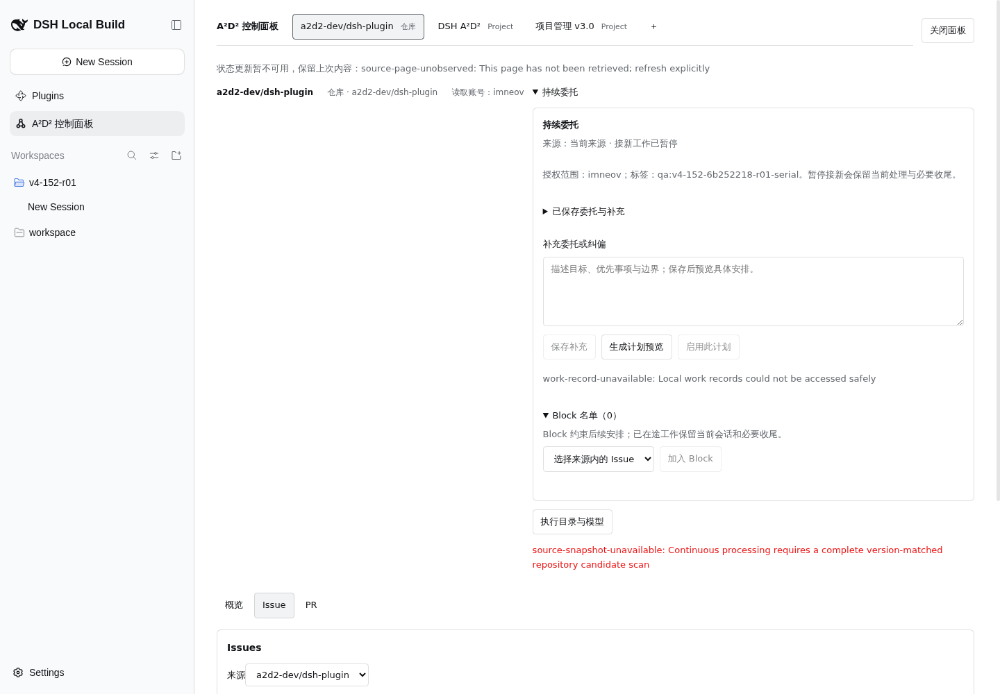

# #152 v4 真实验收第三部分：持续委托被 #163 阻断

## 目的与结论

在既有 preview http://10.126.126.12:18782/ 实测自然语言持续委托、Block、等待让槽、串行推进与关闭补偿。本轮状态为 **blocked，未通过**。已保存硬范围隔离规则及中文委托原话；两次真实计划预览均 HTTP503，未产生有效计划。主会话已将该故障定位并登记为 [#163](https://github.com/a2d2-dev/dsh-plugin/issues/163)。收到主会话“不要再刷 preview”指令后停止页面和服务请求，未重启或修改服务。

仅操作本 run `v4-152-6b252218-r01` 的 A=#160、B=#161、X=#162。未修改 P/C/E、现有开发 Issue、业务代码、Host、插件或 profile。未启用任何计划，未修改 A 的 touch 标签，未关闭 A/B/X。

## 规则身份与服务端边界（已验证）

| 字段 | 真实值 |
|---|---|
| projectId | ec480d94-c5e8-44a0-80a0-897945df1a67 |
| sourceId（仓库） | 9cea4378-0219-4f99-a237-80f51bd36291 |
| 规则 ID | 373d1174-fcb6-49e9-aed0-2ebdb98281aa |
| 最后成功读取的规则版本 | 2 |
| enabled / active / items | false / 无 / [] |
| planning | draftVersion=1、scopeVersion=1、supplements=[]、plans=[]、blocks=[] |
| 硬范围 | assignee=@me，身份 imneov / MDQ6VXNlcjMxNjEyMDMz；必须包含 qa:v4-152-6b252218-r01-serial 标签 |
| runtime / workspace | c01a3a7b-6deb-4820-9896-548d14220162 / b2c6edcf-bb21-4925-8ccd-6b0e503de5dc |
| 执行目录 | /data/_dsh-dev/acceptance-workspaces/v4-152-r01 |
| 配置模型及预设 | codex/gpt-6.1-sol，reasoningEffort=medium；standard / workspace-write |

这些是配置回执与查询事实，**不是模型 request/usage 证据**。仓库对应规则初始不存在，Project1 的 continuous.status 也返回 completed 且无规则，未暂停用户旧规则。只读取硬范围，不以 Issue 搜索筛选冒充服务端授权边界。

目的：防止验收计划纳入已有开发 Issue。步骤：读取来源与 execution-options，核对真实隔离 workspace，读取现有规则，然后通过正式 `/a2d2/api/work` 的 continuous.configure 创建 enabled=false 规则。记录：UI 首次配置只提供目录、模型、预设，页面明文“授权整个当前来源的开放 Issue；浏览中的 Project view 与 Issue 筛选不改变委托范围。已有规则保留原负责人和标签约束。”因此用正式服务端命令首次写入 @me+serial 硬范围。**没有有效计划，无法声称计划 node allow-list 已验收**。

| fixture | GitHub Issue | nodeId | 观察状态 |
|---|---|---|---|
| A | https://github.com/a2d2-dev/dsh-plugin/issues/160 | I_kwDOUmfSE88AAAABY_H0fQ | Open，imneov，run+serial+touch 标签 |
| B | https://github.com/a2d2-dev/dsh-plugin/issues/161 | I_kwDOUmfSE88AAAABY_H3PQ | Open，imneov，run+serial 标签 |
| X | https://github.com/a2d2-dev/dsh-plugin/issues/162 | I_kwDOUmfSE88AAAABY_H6TA | Open，imneov，run+serial 标签 |

以上由真实 gh API 读取，所在 shell 先 export HOME=/root。未用猜测的节点 ID。

## 自然语言保存与预览（保存已验证，预览失败）

目的：真实模型理解原话、生成 A→B 顺序，且预览不执行。步骤：来源表头右侧展开“持续委托”，填写并保存以下原话，再点击“生成计划预览”。

> 本 run v4-152-6b252218-r01 只持续处理 a2d2-dev/dsh-plugin 的专用验收 A=#160、B=#161，顺序必须先 A 后 B。硬范围为分配给 imneov 且带 qa:v4-152-6b252218-r01-serial 标签的开放 Issue；X=#162 明确排除并加入 Block，绝不处理其它开发 Issue、P/C/E、freeland 或 Project14。只在 /data/_dsh-dev/acceptance-workspaces/v4-152-r01 工作，A 仅写 A.proof.json，B 仅写 B.proof.json，禁止 clone 或修改业务代码。先为 A 新建或复用它自己的真实会话，按正文记录身份与 in-progress 后明确 wait 等待 RESUME-A-v4-152-6b252218-r01 并让槽；再推进 B，完成真实 JSON/数量3/stable/SHA256 验收并关闭专用 B。收到真实继续令后 A 保持原 owner/资源重新取得槽并验收；若外部关闭冲突保留本地完成，等待测试器解决后补同步，不重做。当前只保存并预览，明确启用前不得启动 Task/Session 或写 proof。预览必须列出 A→B，每项说明理由、下一步和复用还是新建会话。

记录：首次 configure 返回 HTTP503，但随后 status 查询读到规则 v1；首次 UI instruct 返回 HTTP503 且草稿保留；再次保存成功，规则 v2 含完整原话。两次预览均失败，未得到理由、下一步、新建/复用列表，也没有 planner request/usage/路由 trace，不能宣称调用过模型。configured model 与实际调用严格区分。

| UTC 时间 | 实际动作 / 回执 |
|---|---|
| 02:20:57.263 | configure 返回 HTTP503 work-record-unavailable；后续 query 显示 v1 已落盘，enabled=false |
| 02:22:23.976 | 规则和 Task 基线查询：repo 规则暂停，Project1 无规则，5 个已有 Task 中无 A/B/X |
| 02:23 左右 | 首次 UI 保存原话失败，页面 work-record-unavailable，草稿保留 |
| 02:24:31.411 | UI continuous.instruct，commandId=continuous-ui:6cceff10-2fe1-468c-8991-7dac421e90e3，expectedVersion=1；HTTP200，约13.36秒 |
| 02:25:08.849 | UI continuous.preview，commandId=continuous-ui:8575b2a7-dab3-4d1b-992b-95a35b7f93cc，expectedVersion=2；HTTP503，约11.63秒 |
| 02:25:53.287 | 再次 UI continuous.preview，commandId=continuous-ui:30b30701-53bb-45dc-ba63-35fb0267df95，expectedVersion=2；HTTP503，约12.32秒 |
| 02:26 左右 | 成功 status query：规则 v2，原话在，plans=[]、blocks=[]、items=[]、enabled=false |
| 02:28:11.423 | repo source 只读摘要：version3/sequence17，旧 observations 无 #160-162，无 repositorySnapshot |
| 收口指令前 | serial 列表刷新、专用 X 刷新、正式 Block X 命令都 HTTP503；未启用 |

请求原文和状态见 [保存原话 HAR](part3/02-instruct-network.har)、[两次预览 HAR](part3/04-preview-network.har)、[configure 原始回执](part3/01-configure-response.json)。HAR 去除 cookie/authorization 类头，录制从已登录后开始；该工具 HAR 未收集响应正文，不能将空 content.text 说成完整响应证据。HTTP503 正文来自另行浏览器 API 返回与页面文本。

## Block、零执行和可恢复性（部分验证）

目的：X 被持久 Block 且补充后仍排除。步骤：展开 Block 名单，尝试读取 serial 来源候选、刷新专用 X，最后用真实 X node 发正式 continuous.block。记录：来源候选读取一直 HTTP503，下拉只有“选择来源内的 Issue”，加入 Block 不可用；API Block 也 HTTP503。**实际 blocks=[]，没有成功持久化 X Block**，自然语言排除不等于 Block 名单成功。未保存补充、未重新预览成功，不声称这两项通过。

目的：证明预览没有推进。记录：规则一直 enabled=false，items=[]，没有 active；Task 基线无 A/B/X；预览后 status 仍 plans=[]、items=[]。隔离 proof 文件观察仅 README 与另一执行者的 E.proof.json，无 A/B/X proof。A/B 没有创建 Task/Execution/Session，也无 completionOp，时间线不能填写虚构 ID。浏览器初始化自动建空白 New Session；它发生于规则保存前，不作为 A/B 执行或预览副作用。额外直接 `/api/session/list` 用错 RPC envelope，虽 HTTP200，但 result 为 ok/error，**没有取得有效完整会话差分**，因此严格的全局 Session 零新增断言未完成。

目的：新浏览器或刷新后读回规则。记录：在规则创建前曾关闭 qa152c、重新登录以核对折叠入口；这不验证新规则持久恢复。规则落盘后关闭并重新打开控制面板读回 v1，再保存原话并 query 读回 v2，证明跨页面组件重建可读；**规则创建后的整浏览器关闭恢复与浏览器关闭时宿主自动推进未验证**。未重启 preview，收口指令后没有继续访问。

## 缺陷与复现

[#163](https://github.com/a2d2-dev/dsh-plugin/issues/163) 为主会话登记的产品缺陷。主会话只读诊断为后台发现循环每5秒整库重写约21MB，交互写只等2秒锁，且同进程并发不自旋；这是主会话诊断，不伪装为本执行者独立日志定位。

本执行者复现步骤：登录既有18782 → 仓库来源 → 持续委托 → 正式创建暂停硬范围规则 → 保存原话 → 点击预览；稳定观察预览 HTTP503。另在 Issue 页填 serial 标签并刷新，亦 HTTP503。实际页面文字：

- `work-record-unavailable: Local work records could not be accessed safely`
- `source-snapshot-unavailable: Continuous processing requires a complete version-matched repository candidate scan`
- `状态更新暂不可用，保留上次内容：source-page-unobserved: This page has not been retrieved; refresh explicitly`
- `接新工作已暂停`、`Block 名单（0）`、禁用的“启用此计划”。

调用时序与缺陷原因分开：本执行者进行了两次实际预览和几次读取重试，未高频轮询；页面自身会每5秒观察。这些请求时间可从 HAR 核对，不能把正常预览失败归因于模型。

操作注意：agent-browser 的 snapshot -i 会省略 details/summary，最初误判无持续入口；DOM 核对并点击摘要后入口正常，**不计产品缺陷**。boot rev=abf3d8e5c684，插件entry rev=4eab34b975e0；bootstrap batch=761246ab4baa 与含插件 application batch=e6d73b2ad96b 同时存在，不是旧版本证据。

桌面证据：

移动证据：[390×844 真实页面截图](part3/06-preview-error-390.png)。两张均无口令、cookie 或 token。尺寸已通过图像读取核对。

## 未验证清单与后续恢复窗口

- 有效模型计划与 A→B 排序、why/nextAction/mode、实际 request/usage/推理路由。
- 计划 node allow-list、X Block 持久化与补充自然语言重新预览。
- 明确启用、A-start→A-wait→B-start→B-done→A-resume→A-done、同时至多一项自动推进。
- B 正常真实关闭，A touch 版本冲突、本地完成/远端 Open 分层、补同步保持同一 CompletionOp/Task/Execution/Session 且无模型执行。
- 在途暂停只停新接入、恢复原 owner/资源。
- 关闭浏览器后宿主持久推进、新浏览器读回全部规则/计划/Block/Task/Session。

恢复时需主会话给出修复上线窗口；从现有暂停规则 v2 继续，先读取当前版本，保留原话与硬标签范围，重新完成候选扫描和真实模型预览，仍不得退回固定安排或启用其它业务 Issue。

## 命令与交付

首步 pwd/branch/pull 均成功；gh三项读取成功；浏览器截图、HAR及查询命令 CLI exit0，业务失败由 HTTP503 表达。python 不存在子命令 exit127 后改 python3；首次 git commit 因作者身份缺失 exit128，之后使用命令级既有作者 imneov <i@imneov.im> 成功，未改全局配置。首阶段证据 commit `2aa9d1f`。收口前 git pull --ff-only 为 Already up to date，只 stage 本 part3 文件。结构化状态见 [ledger-part3.json](ledger-part3.json)。
