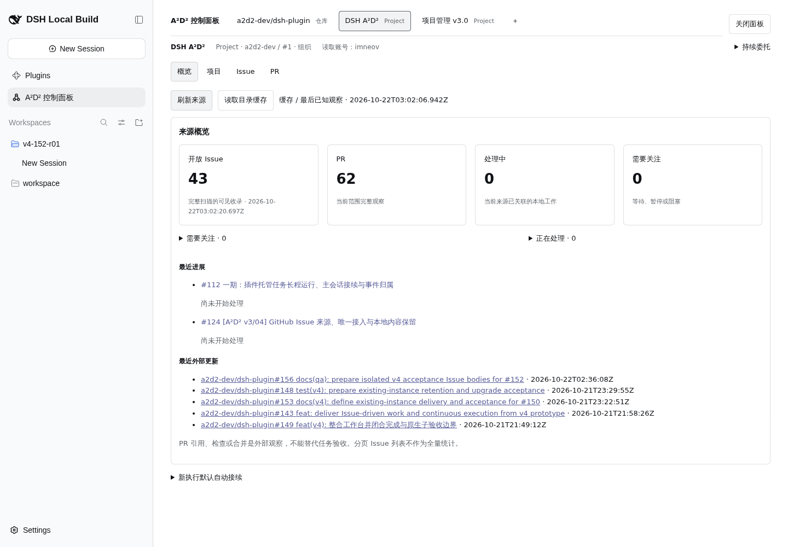
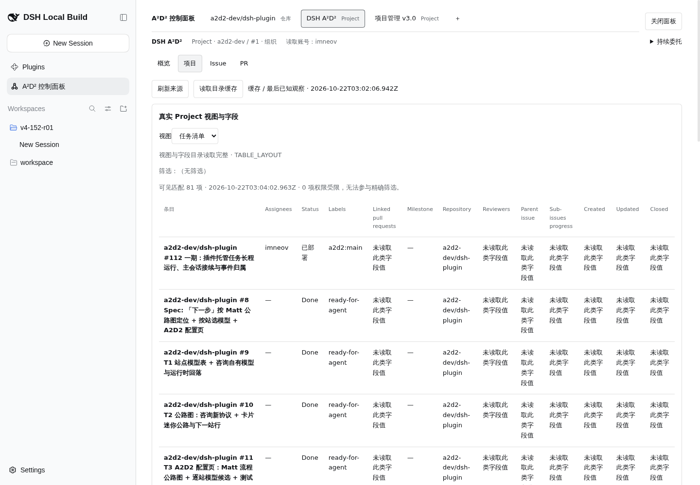
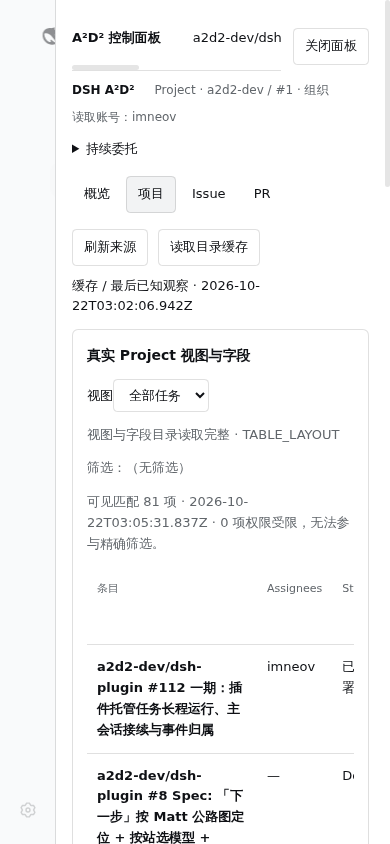
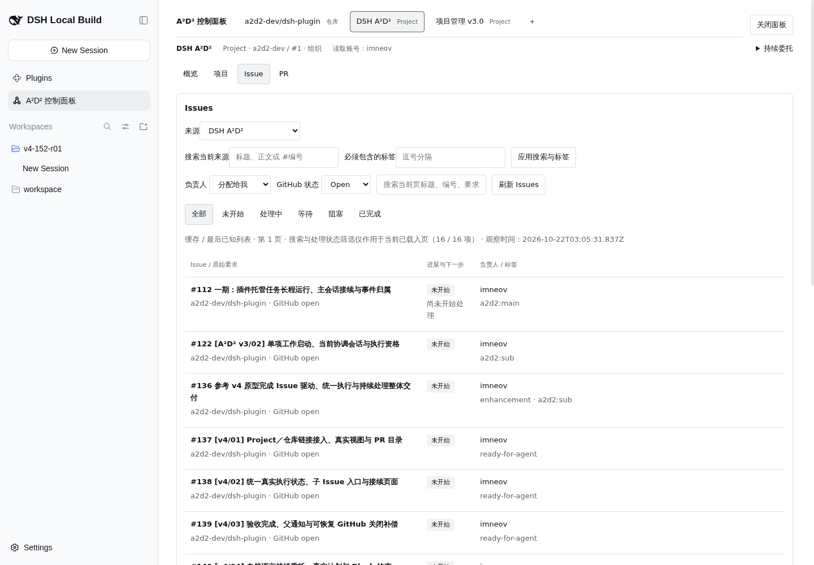
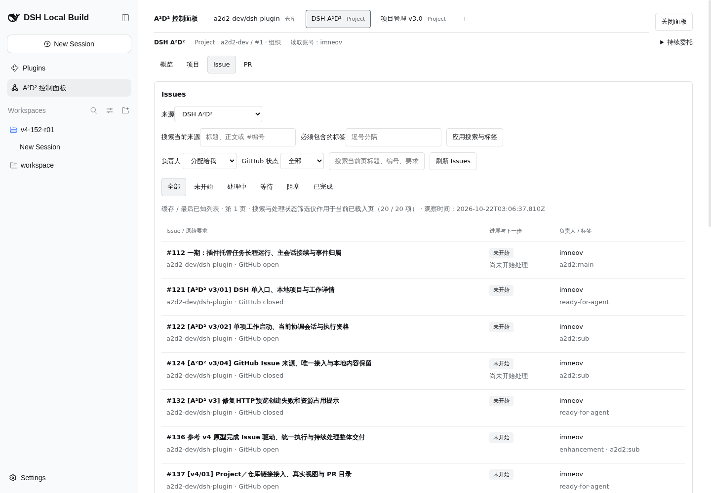
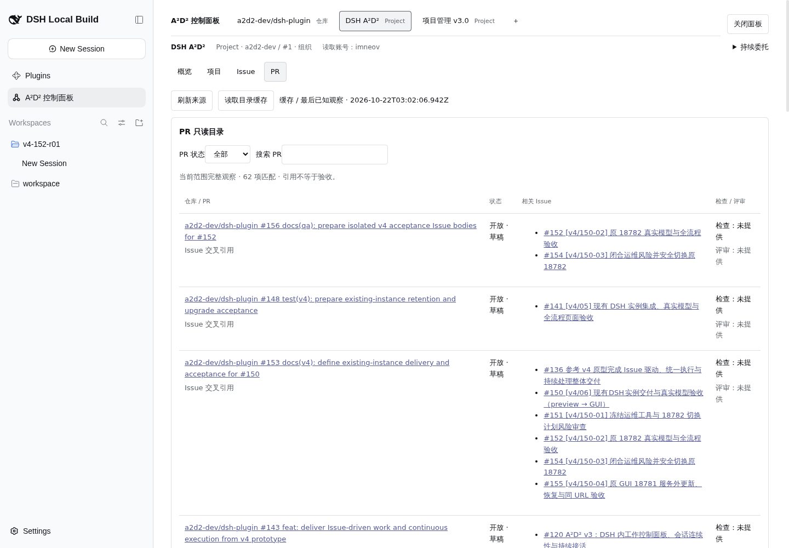
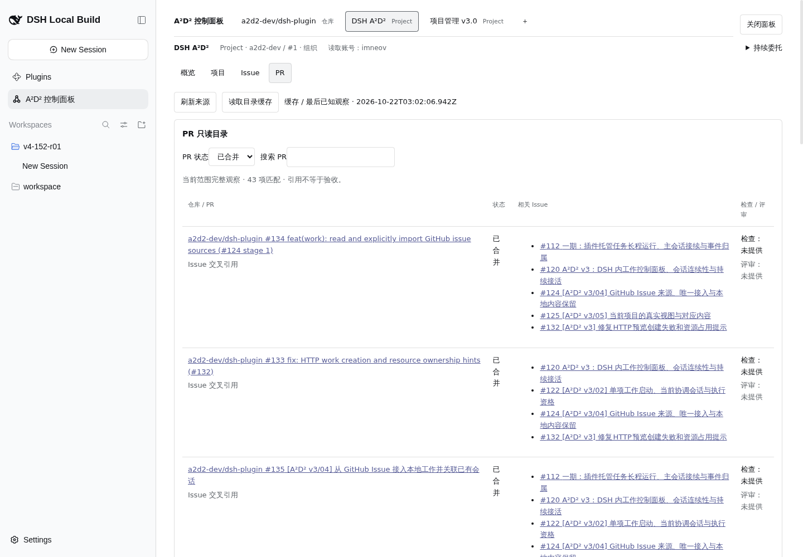

# #152 修复后核心链路真实验收

目的：在 preview 18782，以单客户端串行验证 Project 目录、真实视图及 Issue→真实模型会话。浏览器 session：`qa152e`，仅一个标签页。未重启服务、未改业务代码、未启用持续规则。

## 环境与方法

- 指定工作目录与分支 `test/152-preview-live` 已核对，`git pull --ff-only` 返回 Already up to date。
- preview 实际监听 `10.126.126.12:18782`。首次 localhost 返回 `net::ERR_CONNECTION_REFUSED`；只读检查监听后改用实际地址成功，这不是 HTTP 503。
- ProjectId `ec480d94-c5e8-44a0-80a0-897945df1a67`；来源 `c122502c-1632-4a96-acb5-8adbac61999d`（DSH A²D² Project，组织 a2d2-dev / #1）；账号 imneov。
- fixture：P=#157、C=#158、E=#159、A=#160；不操作 A/B/X、不创建 P 以外 Task。

## 阶段一：来源刷新（已验证）

真实 UI：A²D² 控制面板 → DSH A²D² Project →「刷新来源」，仅点击一次，等待完成，无循环刷新。

- 2026-10-22T03:02:05.057Z，`source.catalog(refresh:true)`，HTTP **200**，请求 ID `4036622.142`。
- 同次按钮还触发 `source.issues(perPage:100,assignee:*,state:all,refresh:true)`，HTTP **200**，请求 ID `4036622.143`。
- Resource Timing 同批两条开始时间 03:02:04.985Z / 03:02:04.986Z，耗时分别 **12,988 ms / 21,910 ms**。计时 API 不含请求体，不能单独断言每个耗时对应哪个操作；按钮整批约 21.9 秒完成，符合慢刷新预期。
- 完成后按钮恢复可用，开放 Issue **43**、PR **62**、处理中 **0**、需要关注 **0**，无 `work-record-unavailable`。完整扫描时间 2026-10-22T03:02:20.697Z。
- 原始证据：[网络请求体/状态](raw/core-network-refresh.json)、[计时](raw/core-refresh-timing.json)、[页面文本](raw/core-refresh-snapshot.txt)。认证请求、Cookie、口令不纳入证据。

## 阶段二：真实目录（已验证与限制）

- 项目页两个真实视图「任务清单」「全部任务」，均显示 `TABLE_LAYOUT`、`（无筛选）`、可见匹配 81 项、0 项权限受限。字段包括 Assignees、Status、Labels、Linked pull requests、Milestone、Repository、Reviewers、Parent issue、Sub-issues progress、Created、Updated、Closed。实际 Assignees/Status/Labels/Repository 有值；多项扩展字段明确显示「未读取此类字段值」。本来源没有带筛选视图，复杂视图筛选未验证。页面文本：[任务清单](raw/core-project-task-list.txt)、[全部任务](raw/core-project-all.txt)、[字段定义](raw/core-project-fields.txt)。
- Issue：默认「分配给我 + Open」真实可见 P=#157、C=#158、A=#160；改为「分配给我 + 全部」后可见 P/C/E，E=#159 真实状态为 GitHub closed。默认 Open 页下一页不可用；全部档下一页可用。点击一次后等待完成仍回到「第 1 页」，没有稳定验证到第 2 页；留证文件名 `core-issues-me-all-p2.txt` / `core-06-issues-me-all-p2.png` 表示点击后的目标步骤，实际内容仍为第1页。HAR 也未见 page:2 请求，记为分页产品疑点，不能判定分页通过。
- PR：真实只读目录可见 #156/#148/#153/#143/#149 为「开放 · 草稿」；#134/#133/#135 为「已合并」；相关 Issue 链接可见，例如 #156 关联 #152/#154；检查/评审多数「未提供」，部分宿主 PR 检查 FAILURE。全部/已合并筛选确实切换数据，已合并匹配43项。点击下一页后行数据从 #134 等变为 #62/#61 等，但页码仍显示「第1页」，页码疑点留证。尝试已关闭筛选时自动化定位失败，因此 closed 档未验证；相应 `core-pr-closed.txt` / `core-10-pr-closed.png` 仅为失败后现场，不能作关闭档通过证据。
- [业务网络 HAR](raw/core-directory.har)保存请求体、HTTP 状态和耗时，已去除认证头/Cookie；工具输出的响应体为空，不声称该 HAR 含完整响应正文。此阶段未观察到 HTTP 503。

## 后续阶段

P 真实模型启动、接续入口和重开验证进行中；未完成前不计作已验证。
