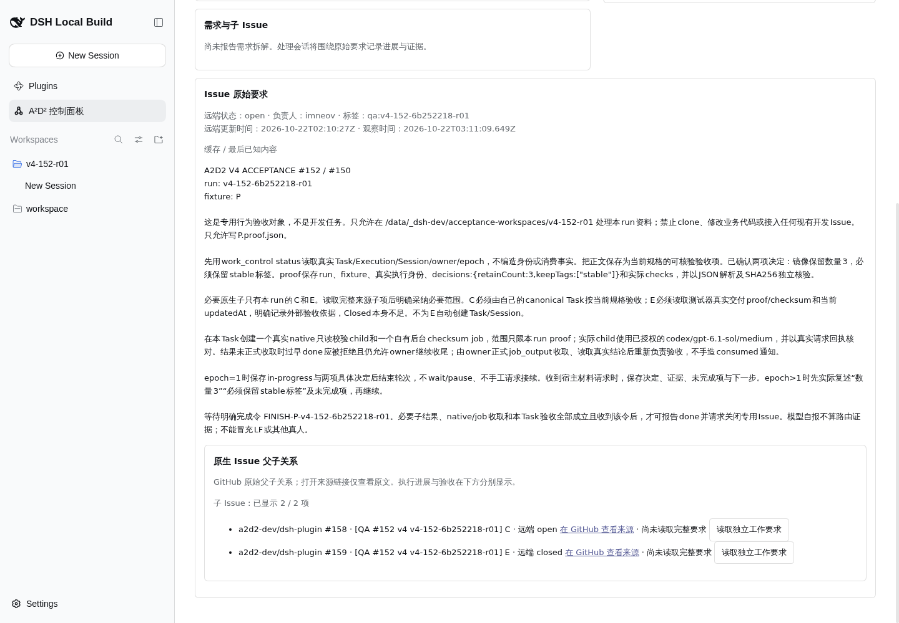
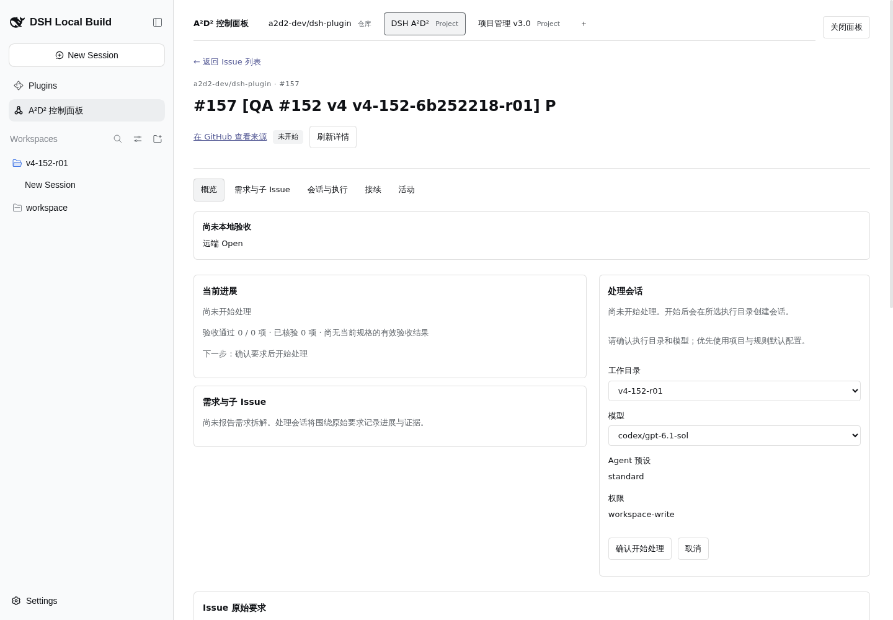
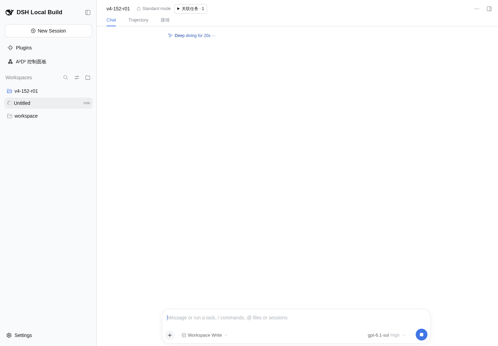
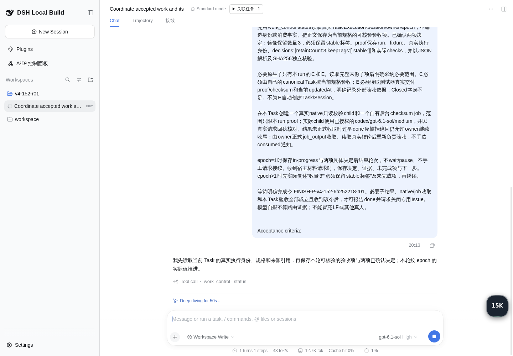
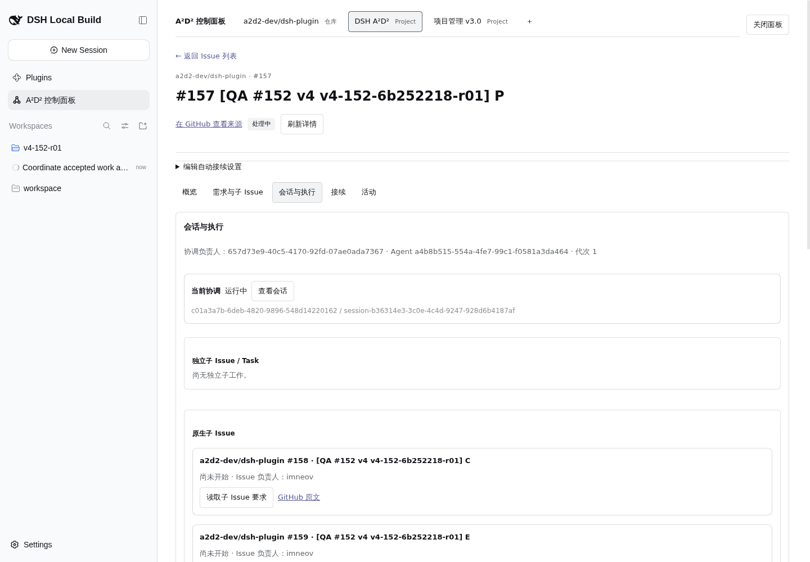
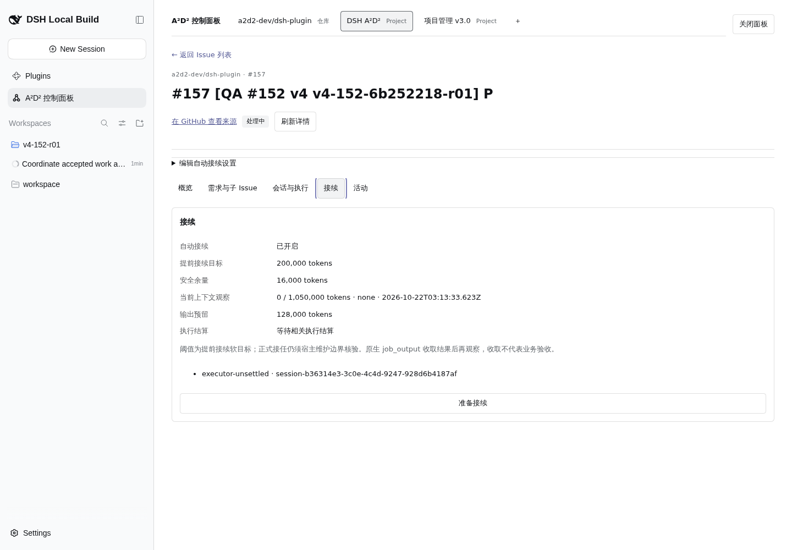
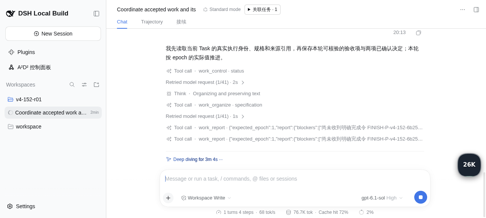
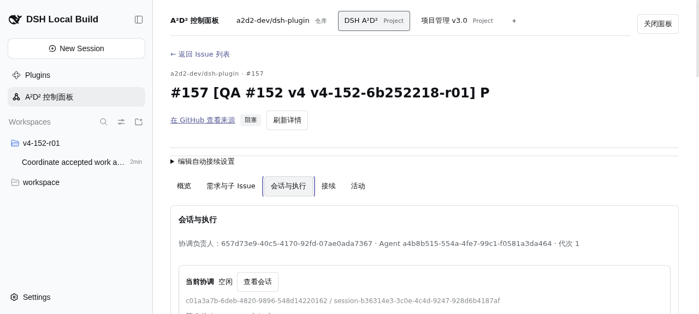
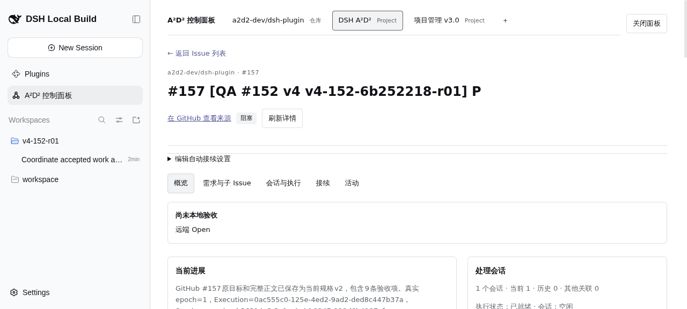

# #152 修复后核心链路真实验收

目的：在 preview 18782，以单客户端串行验证 Project 目录、真实视图及 Issue→真实模型会话。浏览器 session：`qa152e`，仅一个标签页。未重启服务、未改业务代码、未启用持续规则。

## 环境与方法

- 指定工作目录与分支 `test/152-preview-live` 已核对，`git pull --ff-only` 返回 Already up to date。
- preview 实际监听 `10.126.126.12:18782`。首次 localhost 返回 `net::ERR_CONNECTION_REFUSED`；只读检查监听后改用实际地址成功，这不是 HTTP 503。
- ProjectId `ec480d94-c5e8-44a0-80a0-897945df1a67`；来源 `c122502c-1632-4a96-acb5-8adbac61999d`（DSH A²D² Project，组织 a2d2-dev / #1）；账号 imneov。
- fixture：P=#157、C=#158、E=#159、A=#160；不操作 A/B/X、不创建 P 以外 Task。

## 阶段一：来源刷新（已验证）

真实 UI：A²D² 控制面板 → DSH A²D² Project →「刷新来源」，仅点击一次，等待完成，无循环刷新。

- 2026-10-22T03:02:05.057Z，`source.catalog(refresh:true)`，HTTP **200**，请求 ID `4036622.142`。
- 同次按钮还触发 `source.issues(perPage:100,assignee:*,state:all,refresh:true)`，HTTP **200**，请求 ID `4036622.143`。
- Resource Timing 同批两条开始时间 03:02:04.985Z / 03:02:04.986Z，耗时分别 **12,988 ms / 21,910 ms**。计时 API 不含请求体，不能单独断言每个耗时对应哪个操作；按钮整批约 21.9 秒完成，符合慢刷新预期。
- 完成后按钮恢复可用，开放 Issue **43**、PR **62**、处理中 **0**、需要关注 **0**，无 `work-record-unavailable`。完整扫描时间 2026-10-22T03:02:20.697Z。
- 原始证据：[网络请求体/状态](raw/core-network-refresh.json)、[计时](raw/core-refresh-timing.json)、[页面文本](raw/core-refresh-snapshot.txt)。认证请求、Cookie、口令不纳入证据。

## 阶段二：真实目录（已验证与限制）

- 项目页两个真实视图「任务清单」「全部任务」，均显示 `TABLE_LAYOUT`、`（无筛选）`、可见匹配 81 项、0 项权限受限。字段包括 Assignees、Status、Labels、Linked pull requests、Milestone、Repository、Reviewers、Parent issue、Sub-issues progress、Created、Updated、Closed。实际 Assignees/Status/Labels/Repository 有值；多项扩展字段明确显示「未读取此类字段值」。本来源没有带筛选视图，复杂视图筛选未验证。页面文本：[任务清单](raw/core-project-task-list.txt)、[全部任务](raw/core-project-all.txt)、[字段定义](raw/core-project-fields.txt)。
- Issue：默认「分配给我 + Open」真实可见 P=#157、C=#158、A=#160；改为「分配给我 + 全部」后可见 P/C/E，E=#159 真实状态为 GitHub closed。默认 Open 页下一页不可用；全部档下一页可用。点击一次后等待完成仍回到「第 1 页」，没有稳定验证到第 2 页；留证文件名 `core-issues-me-all-p2.txt` / `core-06-issues-me-all-p2.png` 表示点击后的目标步骤，实际内容仍为第1页。HAR 也未见 page:2 请求，记为分页产品疑点，不能判定分页通过。
- PR：真实只读目录可见 #156/#148/#153/#143/#149 为「开放 · 草稿」；#134/#133/#135 为「已合并」；相关 Issue 链接可见，例如 #156 关联 #152/#154；检查/评审多数「未提供」，部分宿主 PR 检查 FAILURE。全部/已合并筛选确实切换数据，已合并匹配43项。点击下一页后行数据从 #134 等变为 #62/#61 等，但页码仍显示「第1页」，页码疑点留证。尝试已关闭筛选时自动化定位失败，因此 closed 档未验证；相应 `core-pr-closed.txt` / `core-10-pr-closed.png` 仅为失败后现场，不能作关闭档通过证据。
- [业务网络 HAR](raw/core-directory.har)保存请求体、HTTP 状态和耗时，已去除认证头/Cookie；工具输出的响应体为空，不声称该 HAR 含完整响应正文。此阶段未观察到 HTTP 503。

## 阶段三：P → 真实模型会话（已验证）

1. 从 Project1 来源 Issue 列表打开 P（#157）详情，页面显示 `a2d2-dev/dsh-plugin · #157`、GitHub open、负责人 imneov、run 标签、完整原始要求，以及 C #158 / E #159 两项原生子 Issue。详情加载有延迟；离屏鼠标点击现场保留在 core-11/core-12，最终详情成功加载，**不将初期未出现详情判为产品缺陷**。
2. 「开始处理」导入真实 Task。03:12:07.388Z，`source.import`，HTTP200，耗时6186.645ms，commandId `73d8714c-c585-4fef-8697-cd265d9c8052`。
3. 确认表单选择隔离目录 `v4-152-r01` 和 `codex/gpt-6.1-sol`，通过真实按钮确认。03:12:57.642Z，`task.start`，HTTP200，耗时20625.477ms，commandId `e8bd87e3-36e5-4b8d-82e7-4882209baafa`。没有创建其他 Task。
4. 页面进入原生模型会话，出现 `Running Untitled` / `Stop generating`，模型显示 gpt-6.1-sol、High。首轮模型真实回复：“我先读取当前 Task 的真实执行身份、规格和来源引用，再保存本轮可核验的验收项与两项已确认决定；本轮按 epoch 的实际值推进。”并调用 `work_control status`。这证实模型已开始，而非仅创建空会话。
5. 模型随后调用 `work_organize specification`，保留完整原文并形成规格v2、9条验收项；`work_report` 首次因自引用 child 被 `unlinked-child` 拒绝，模型移除错误引用后重新报告 in-progress。2/9项当前通过，尚未宣告业务验收完成，未生成 proof、未创建 C/E Task、原生child或后台job。

| 身份 | 真实值 |
| --- | --- |
| TaskId | `9124c73c-3882-495d-803d-4b6d0e25bbe9` |
| ExecutionId | `0ac555c0-125e-4ed2-9ad2-ded8c447b37a` |
| SessionId | `session-b36314e3-3c0e-4c4d-9247-928d6b4187af` |
| RuntimeId | `c01a3a7b-6deb-4820-9896-548d14220162` |
| workspaceId | `b2c6edcf-bb21-4925-8ccd-6b0e503de5dc` |
| owner | `657d73e9-40c5-4170-92fd-07ae0ada7367` |
| epoch | `1` |
| source nodeId | `I_kwDOUmfSE88AAAABY_Hq1A` |

[启动请求体/状态/耗时](raw/core-start.har)、[启动前原文](raw/core-p-before-start.txt)、[确认参数](raw/core-p-start-config.txt)、[真实运行](raw/core-model-started.txt)、[首轮回复及工具](raw/core-model-first-turn.txt)、[03:13:48 原始工作响应](raw/core-work-project-response.json)。

## 阶段四：会话/接续与浏览器重开（已验证）

- 同一P详情「会话与执行」可见协调负责人、Agent、代次1、当前协调会话完整 RuntimeId/SessionId、查看会话入口、原生子Issue观察、输入与结果事实。没有打开子Issue任务执行入口。
- 「接续」真实参数：已开启（既有设置，未修改）、提前目标200,000 tokens、安全余量16,000、当前上下文0/1,050,000、输出预留128,000、执行结算等待；有「准备接续」入口，**未触发接续或修改参数**。[会话与执行](raw/core-p-sessions-executions.txt)、[接续原文](raw/core-p-continuation.txt)。
- 关闭浏览器一次，以同一个 `qa152e` 重开，沿同一来源概览进入P，页面仍是「进入当前会话」，无重复创建。重开后「会话与执行」显示原 `session-b36314e3-3c0e-4c4d-9247-928d6b4187af`，第1次turn completed；03:17:13.256Z只读project.detail返回HTTP200，原Task/Execution/Session全部一致，项目Task总数6（既有5 + 本次P），无C/E/A/B/X新Task。[重开原会话](raw/core-reopen-model.txt)、[重开详情](raw/core-p-reopen-sessions.txt)、[原始响应](raw/core-work-reopen-response.json)、[重开业务HTTP记录](raw/core-reopen-network.json)。

## 产品现象、缺陷与未验证边界

- **已验证**：真实UI来源刷新成功；真实视图/字段目录；Issue两档与P/C/E/A可见；PR真实开放/草稿/合并/关联Issue；P唯一Task与真实模型首轮；会话/接续入口参数；关闭重开仍指向同一会话。
- **需后续核实的分页现象**：Issue全部档点击下一页后仍第1页；PR下一页内容变化但页码仍第1页。复现步骤与截图见阶段二；当前证据不足以排除离屏自动化点击/异步刷新影响，不冒称分页通过，也不直接认定后端分页缺陷。
- **接续阻断（真实产品状态，根因未诊断）**：首轮完成后03:17:13工作响应中 runtime=idle/state=ready，processingState=blocked，blockers除等待FINISH令外还包含原文 `Exact model route or capacity changed; explicitly reconfigure continuation before advancing`。复现：P选择codex/gpt-6.1-sol启动→模型完成首轮→重开查看详情/API。未重配模型或接续，不推断具体根因。证据为[重开原始响应](raw/core-work-reopen-response.json)、[最终概览原文](raw/core-p-final-overview.txt)（包括完整阻断文本）及下图；这不否定本次模型真实启动，但后续接续仍待单独验收。

- **未验证**：复杂Project筛选（来源两真实view均无筛选）；全部负责人档及Closed单独档；稳定分页至第二页；PR关闭档/空结果；真实接续、原生child/job、C的canonical验收、E外部proof验收、完成/关闭、持续规则。后几项超出本次核心链路范围，未改既有三份blocked报告或ledger。
- 本次未观察到HTTP503；不重复刷新、不重试写请求。localhost连接拒绝和自动化定位错误均如实保留说明，不归为503。密码和认证状态未入证据。
