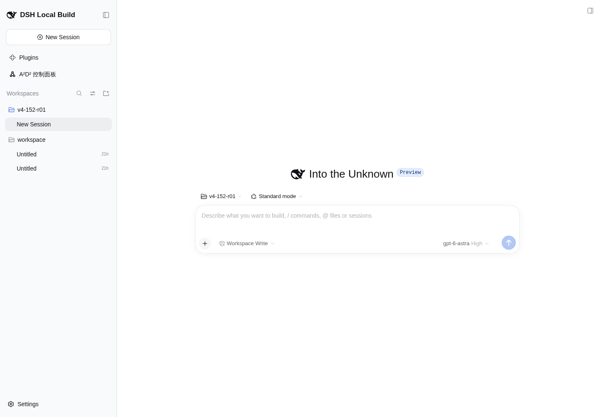
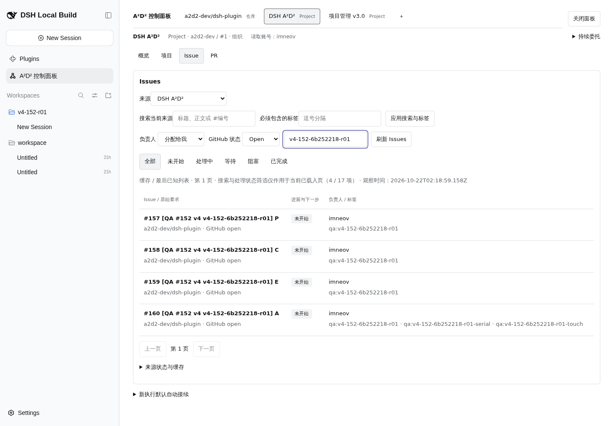
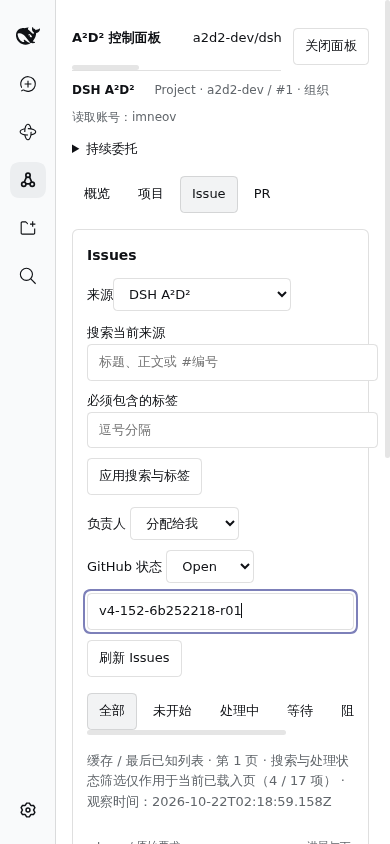
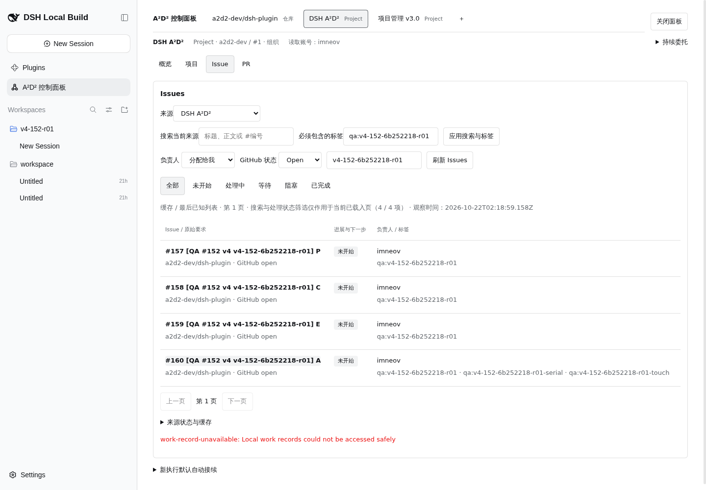

# #152 v4 真实 preview 验收：准备与目录页面

run：`v4-152-6b252218-r01`；目标：<http://10.126.126.12:18782/>。

## 阶段一：准备与既有持续规则（已验证）

目的：确认隔离条件，不修改既有规则，不让 fixture 被旧规则接入。

步骤：第一条命令在锁定 worktree 执行 `pwd && git branch --show-current`，得到 `/data/src/github.com/a2d2-dev/dsh-plugin.worktrees/v4-152-live-acceptance` 与 `test/152-preview-live`。读取 agent-browser core，登录原 preview，关闭 Preview Notice，进入 A²D² 面板，展开“持续委托”，正式查询全部三个项目、三个来源的 continuous.status。

记录：

| 来源范围 | 来源 ID | 原话 | 是否启用 |
| --- | --- | --- | --- |
| a2d2-dev/dsh-plugin Repo | `9cea4378-0219-4f99-a237-80f51bd36291` | 无已保存规则（API 没有 continuousRule） | 无已保存规则 |
| a2d2-dev Project 1 | `c122502c-1632-4a96-acb5-8adbac61999d` | 无已保存规则；页面输入框空 | 页面“接新工作已暂停”，API 无 continuousRule |
| theriseunion Project 14 | `6de5b019-9765-45dd-8596-1a02dbaa7cca` | 无已保存规则（API 没有 continuousRule） | 无已保存规则 |

三个正式 status 响应都是 HTTP 200 / `status:completed`，没有规则实体。没有发现宽范围旧规则冲突；保留原规则不变。Project14 只为完整规则盘点查询了状态，未刷新业务 Issue、未执行其工作。三个项目中，独立历史验收项目没有来源。

既有来源直接复用，没有重复添加。Project1 来源页面当前缓存概览显示“缓存 / 最后已知观察 · 尚无目录缓存”，开放 Issue 40（完整扫描 2026-10-22T02:03:59.496Z），PR“尚未完整观察”，本地工作聚合“尚未读取”。这些是页面观察，不当作新鲜完整扫描。

原始命令与退出码保存在 `raw/baseline-*.json`，本轮 capture 脚本 exit 0；每个命令 exit 0。Project14 的 source.list 原响应包含约33MB无关业务 Issue 缓存，最终证据明确投影为来源身份/范围/启用元数据，保留原 stdout 的 SHA256 与字节数；持续规则 status 独立原始回执未裁剪。注意初次尝试 `/api/session/list` 使用空 body，返回 HTTP 200 但业务错误 `gateway/bad-request` / `invalid client-request message`，不能当有效会话数量证据；保留原响应，后续以正确 RPC 与页面核对。

规格读取说明：当前验收分支没有规格文件；依父会话提供路径，只读读取交付 worktree 的 `docs/specs/v4-live-acceptance-script.md`。fixture 六份正文与 ledger template 以本分支内容为准。已有未跟踪 `.local/` 不变。

## 阶段二：workspace 与 GitHub 对象

目的：建立只属于本 run 的资源与外部对象，保留真实身份供后续执行。

步骤：创建隔离目录 README，通过 Add workspace → Edit path → 输入完整路径 → Enter → Open 正式注册。随后 resources.list 查询，再调用幂等 workspace/create 回读已注册记录（created:false）。GitHub 使用精确六份 body-file 创建，assign imneov，创建三个本 run 标签；POST 两条原生 sub_issues 后 GET 回读；只添加 P/C/E/A 到 Project1。

记录：正式路径 `/data/_dsh-dev/acceptance-workspaces/v4-152-r01`，runtimeId `c01a3a7b-6deb-4820-9896-548d14220162`，workspaceId `b2c6edcf-bb21-4925-8ccd-6b0e503de5dc`，createdAt `2026-10-22T02:09:20.666Z`。Host 自动生成空 Session `session-df9adec7-379c-482d-bb4d-0f0ccc493351`；这属于 workspace 初始化，不能声称整个准备阶段零 Session。正式 session/list 回读 blank:true、running:false、0 turns / steps / tokens。初次根页 /session/create 请求不能单凭请求次数断言新建：旧 blank Session 仍为原旧时间，未证实新增根 Session。

| fixture | 真实 Issue | database ID | Project item ID |
| --- | --- | --- | --- |
| P | [#157](https://github.com/a2d2-dev/dsh-plugin/issues/157) | 5971765972 | `PVTI_lADODqZowM4BnNzFzhCk6LI` |
| C | [#158](https://github.com/a2d2-dev/dsh-plugin/issues/158) | 5971766749 | `PVTI_lADODqZowM4BnNzFzhCk6NY` |
| E | [#159](https://github.com/a2d2-dev/dsh-plugin/issues/159) | 5971767556 | `PVTI_lADODqZowM4BnNzFzhCk6Ns` |
| A | [#160](https://github.com/a2d2-dev/dsh-plugin/issues/160) | 5971768445 | `PVTI_lADODqZowM4BnNzFzhCk6Sg` |
| B | [#161](https://github.com/a2d2-dev/dsh-plugin/issues/161) | 5971769149 | 不加入 |
| X | [#162](https://github.com/a2d2-dev/dsh-plugin/issues/162) | 5971769932 | 不加入 |

Project1 的真实 ID 为 `PVT_kwDODqZowM4BnNzF`。完整 node_id / updatedAt / URL / 标签 / assignee 见 [ledger](ledger.json)。P 原生子回读仅 #158/#159，数据库 ID 与正文一致；没有创建 Task/Execution/规则，没有设置执行模型。新 workspace 尚未附到任何新的 A²D² project，ledger.projectId 保持 null，避免误用旧演示执行资源。

创建脚本与全部 gh 子命令 exit 0。Git 首次 commit 因未配置作者 exit 128，读取已有作者后使用命令级 `-c user.name=imneov -c user.email=i@imneov.im` 完成，没有修改全局配置。RPC 探索错误保留 raw（缺少 args、缺少 _request），最终有效格式为 client-request / method session/list / payload.args._request:{}，正式返回 ok:true。

## 阶段三：目录、双来源详情与副作用

本节截至 2026-10-22T02:27:35Z。已完成页面走查与证据保存；canonical 双来源详情、Project 实际视图字段与可操作分页仍待串行复测，不能判为通过。

### 3.1 来源目录、真实字段、缓存与状态（页面走查已验证，部分数据未验证）

目的：在真实应用中检查来源导航、字段、缓存与错误表达。

步骤：依次进入 Repo 的概览 / Issue / PR，Project1 的概览 / 项目 / Issue / PR；每页采集 1440×1000 和 390×844。读取缓存后按 UI 显式刷新，等待并记录网络响应，保留加载中与结束后的状态。Repo 只有三页，没有“项目”页；探索脚本误点 Repo“项目”返回 element not found，已修正脚本，原失败记录保留，这不是产品缺陷。

记录：

| 场景 | 真实可见事实 | 桌面 / 移动截图 |
| --- | --- | --- |
| Repo 概览初次缓存 | 来源为仓库；读取账号 imneov；“尚无目录缓存”；开放 Issue、PR 尚未完整观察；刷新后出现 source-catalog-unobserved | [桌面](shots/04-repo-overview-refresh-desktop.png) / [移动](shots/04-repo-overview-refresh-mobile.png) |
| Repo Issue 旧缓存 | 第1页 3/3 项；2026-10-20T15:45:03.372Z；#124 closed、#122/#112 open；标题、仓库、负责人、标签和进展分栏；上一页/下一页均 disabled。Open 下仍见旧 closed 项，页面明确是旧缓存，不当作新鲜 Open 结果 | [桌面](shots/06-repo-issues-desktop.png) / [移动](shots/06-repo-issues-mobile.png) |
| Repo PR 初次 | 无可读目录缓存；提示刷新，未把失败写成空目录 | [桌面](shots/07-repo-prs-desktop.png) / [移动](shots/07-repo-prs-mobile.png) |
| Project1 概览 | 来源标签 Project，组织 a2d2-dev/#1；初始开放 Issue 40 为旧完整扫描；目录缓存不可读时如实提示 | [桌面](shots/09-project-overview-refresh-desktop.png) / [移动](shots/09-project-overview-refresh-mobile.png) |
| Project1 项目页加载中 | 页面“正在读取来源目录…”；“尚无真实 Project 视图缓存，请刷新来源。” | [桌面](shots/10-project-projects-desktop.png) / [移动](shots/10-project-projects-mobile.png) |
| Project1 项目页稳定状态 | source-catalog-unobserved；未取得真实 view URL/参数与 Project 字段 | [桌面](shots/14-project-projects-error-stable-desktop.png) / [移动](shots/14-project-projects-error-stable-mobile.png) |
| Project1 PR 稳定状态 | “PR 目录尚无可读缓存，请刷新来源；读取失败不表示空目录。” | [桌面](shots/13-project-pr-error-stable-desktop.png) / [移动](shots/13-project-pr-error-stable-mobile.png) |
| Repo 概览最终缓存 | 观察时间 2026-10-22T02:23:49.226Z；开放 Issue 45（GitHub全仓库计数）、PR73（当前范围完整观察）、已关联本地处理0/关注0；最近外部更新含 #148/#153/#156/#143/#149，保留“状态更新暂不可用”横幅 | [桌面](shots/22-repo-overview-final-desktop.png) / [移动](shots/22-repo-overview-final-mobile.png) |

加载截图与稳定截图按时间分别保留，不能只用第一次 networkidle 就认定数据已完成。本轮没有人为制造服务断网、空仓库或 GitHub outage；只记录实际遇到的读取中、缓存、不可用与本地筛选空状态。真实 Project view 字段和可翻到下一页的数据未验证，现有页的分页按钮状态已观察。

### 3.2 四个 fixture 在 Project 来源可见（已验证缓存可见）

目的：确认加入 Project 的专用四项确实进入应用来源，而不修改 Project 其他条目。

步骤：gh Project item-list 正式回读四个 item ID；Project1 → Issue → 刷新 Issues；列表读到 17项、观察时间 2026-10-22T02:13:33.038Z；当前页输入 nonce 筛成四行。之后按 run 标签过滤得到4项缓存，观察时间 2026-10-22T02:18:59.158Z。

记录：P#157/C#158/E#159/A#160 全部可见，标题、仓库、GitHub open、imneov、各标签真实显示。B/X 没有加入 Project；gh item-list 100条上限返回的全清单中未见161/162。刷新请求曾503，因此此项只判“真实缓存列表可见”，不宣称每次刷新成功。Project item 与 Issue 的外部映射见 ledger 及 raw/github-project-items-confirm.json。

### 3.3 双来源 canonical 详情（未验证）

目的：从 Repo 与 Project 打开同一 A，核对唯一身份，且不创建 Task。

步骤：Repo 旧页没有 A；按 run 标签查询并刷新，返回503。正式查询 source.issue 对 Repo/Project 的 A（number160、nodeId `I_kwDOUmfSE88AAAABY_H0fQ`）各一次 refresh:true，均返回 work-record-unavailable。改查缓存：Repo 返回 source-content-unavailable / Issue content has never been retrieved；Project 缓存返回 completed、同一真实 nodeId，且无 binding。再从 Project 四行列表点击 A，页面仍停列表并显示503。

记录：A 尚未创建 Task（本次 Project 缓存回执无 binding），不能给出 TaskId/ExecutionId/Session，也未点击开始处理或 source.import。仅 GitHub node 身份已确认，尚未完成“从 Repo 与 Project 各打开详情并复用 canonical Task”的页面验收。需等串行恢复后复测，执行身份以 part2 为准。

[对应移动截图](shots/20-project-open-A-error-mobile.png)。原始回执为 raw/direct-{repo,project}-A-detail.json、raw/cached-{repo,project}-A-detail.json、raw/window-error-3809542.872.json。

### 3.4 本地空结果与来源切换（已验证有限可见事实）

目的：区分无匹配筛选和读取失败，并观察切换后页面归属。

步骤：Project 当前页搜索 `NO-MATCH-v4-152-6b252218-r01`，再恢复 nonce；从 Repo Issue 点刷新，立即切 Project1；保存切换后页面。切换后来源默认进入概览，之前误在概览寻找“刷新 Issues”的自动化失败已保留，不作为产品失败。

记录：本地筛选显示“0 / 4 项”“当前页没有匹配筛选的 Issue。”，同时保留本地记录不可用 alert，未声称远端源为空。Repo→Project 后，最终页头与导航为 Project1，未见旧 Repo 内容抢占；当前页 nonce 和标签输入在往返后仍保留。这里只证明本次真实切换的可见事实，没有注入延迟响应，不能证明所有竞态。

[空结果桌面](shots/21-project-local-empty-desktop.png) / [空结果移动](shots/21-project-local-empty-mobile.png)；[切换后桌面](shots/24-switch-final-project-desktop.png) / [切换后移动](shots/24-switch-final-project-mobile.png)。

### 3.5 浏览/来源识别不启动工作（限定窗口已验证）

目的：排除本验收者的来源浏览与识别触发模型、Task、Session 或规则启用。

步骤：单独清空浏览器网络历史（排除登录请求），执行页面浏览、筛选、重复 Repo 链接识别、A 详情尝试；导出真实网络记录，剔除 HTTP headers。重复 Repo 被识别，页面按钮仍写“确认添加并进入概览”；依父会话要求复用既有来源，未按该按钮，因此“再次确认添加是否幂等”未验证。此后关闭 A²D² 面板停止轮询。

记录：该窗口共300条实际请求，全部为 A²D² query：project.detail65、source.list65、source.issues74、continuous.status89、source.catalog3、source.identify1、source.issue3；command0，非work请求0。没有 source.import/task.start/continuous 保存或启用，没有 session/create 或模型请求。旧规则基线无实体，自己的窗口未做任何规则命令；GitHub 创建后独立回读六项全 Open、标签/assignee 正确。窗口正式原文在 raw/side-effect-network-window.json 与 raw/side-effect-summary.json。

有效 session/list 基线4个：原三个仍在，加 workspace 初始化空 Session；空 Session 为0 turns/steps/usage。浏览前后侧栏保持同一 workspace 空 New Session 与旧会话展示，见 baseline/workspace/final-sidebar 快照。**这不能扩展为整个准备阶段零 Session**，Add workspace 确实创建了空 Session。也不能把全局新增数作为浏览归因：父会话已通知 qa152b 并行执行 P/C/E，后续其 Task、Session、模型变化不在本窗口的零启动结论内。本阶段不把零请求记录冒充 Host 全局模型账单审计。

重复来源识别：[桌面](shots/19-repo-identify-existing-desktop.png) / [移动](shots/19-repo-identify-existing-mobile.png)。最初尝试覆盖 window.fetch 的观察数组始终空，不能反证无网络；保留 raw/network-mid.json，最终以浏览器实际网络记录为准。

## 产品缺陷与复现条件

**D1：[产品缺陷 #163](https://github.com/a2d2-dev/dsh-plugin/issues/163)：并发刷新/详情读取导致 HTTP503，本地工作记录不可用，阻断目录与详情验收。**

目的：保留真实失败与后续复测边界。

复现步骤：在保留既有数据的原18782中，多个客户端同时打开 A²D² 面板并轮询；进入 Repo 或 Project1，点刷新 Issues，或从 Project1 列表点 A。实际请求如3809542.784/.812/.848/.872/.928，均是正式 query 且 refresh:true。返回 HTTP503，正文 `{"status":"failed","error":{"code":"work-record-unavailable","message":"Local work records could not be accessed safely"}}`（含 source 的较长回执也原样保存）。页面显示 `work-record-unavailable: Local work records could not be accessed safely`，保留旧缓存。此前无可读目录缓存时，后续 refresh:false 又返回400 source-catalog-unobserved 或 source-page-unobserved，页面仍明确表示未读取，不应当成空结果。

真实证据：raw/network-detail-538.json、raw/window-error-3809542.784.json、raw/window-error-3809542.812.json、raw/window-error-3809542.848.json、raw/window-error-3809542.872.json、raw/window-error-3809542.928.json，截图18-repo-label-search-error、20-project-open-A-error，均有桌面与移动版本。控制台与未捕获错误列表实际为空（raw/browser-console.json、raw/browser-errors.json），错误在网络与页面 alert 中。

主会话诊断（来源为父会话通知，非本子阶段独立代码诊断）：工作库为全局单文件+单写锁，约20MB历史数据，每次写整文件解析/序列化，锁仅等待2s；三个浏览器并发轮询/刷新使写锁争用。不能把该诊断冒充本阶段已复测的根因。按主会话指令已停止全部 refresh:true 并关闭 qa152 的面板，等待其单客户端串行复测结果。本阶段未改存储、未重启、未变更权限或部署。

主会话已确认并登记 #163，补充定位为“后台发现循环每5s整库重写 + 交互写只等2s锁 + 同进程并发不自旋”，在独立 worktree 修复并计划重新部署。依其明确收口指令，本 part1 以缺陷与未验证项交付，不再访问 preview；修复后串行复测尚未在本报告执行。

## 下一阶段交接与未验证项

- workspace 正式资源见 ledger.resourceRef；目录 README 只允许本run资料。workspace 尚未附到新的 A²D² project，本阶段 projectId/defaultAgentId/ruleId 为 null，不应据此使用旧演示项目资源执行。
- P#157 的必要原生子为 C#158、E#159；E/X 本阶段没有 import，E 外部交付由执行阶段负责，X 无 proof。串行 node allow-list 只含 A/B，不能把 X 加入启用计划。
- A 的 touch 标签已经存在。六项完成令/RESUME 令以原正文为准；本阶段未生成 proof、未调用模型、未关闭 fixture，未启用持续规则。
- 父子执行、接续、native child/job 正式收取、真实请求模型与权限、持续委托、Block 和关闭补偿不在 part1 通过范围内，按父会话安排由 part2/后续阶段执行。
- 必须串行补测：Repo 读取本run fixture；双来源打开同一 A/C 的详情及 canonical 复用；Project真实视图/字段；PR列表字段与有效分页；根因缓解后目录刷新成功。当前不能将这些项目判为已通过。

## 交付校验

本 part1 共44张真实截图：1440×1000为23张、390×844为21张（另两张是准备/注册桌面基线）。所有报告截图链接已核验存在，所有本阶段JSON可解析，`git diff --check` exit 0；没有运行业务代码测试。原始失败命令保留退出码，业务HTTP错误与CLI exit 0分别记录。证据SHA256见 [校验清单](sha256-manifest.json)，校验结果见 [artifact validation](raw/part1-artifact-validation.json)；清单明确排除其他执行者的part2文件。

## 范围

本阶段不创建 Task，不启动模型，不启用规则；执行、父子验收、自动接续与持续处理交给后续阶段。服务、Host、插件、profile 与 src/ 未修改。
