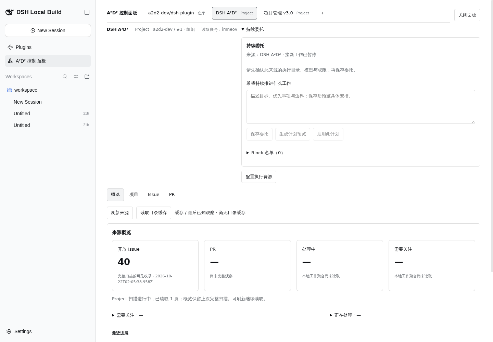

# #152 v4 真实 preview 验收：准备与目录页面

run：`v4-152-6b252218-r01`；目标：<http://10.126.126.12:18782/>。

## 阶段一：准备与既有持续规则（已验证）

目的：确认隔离条件，不修改既有规则，不让 fixture 被旧规则接入。

步骤：第一条命令在锁定 worktree 执行 `pwd && git branch --show-current`，得到 `/data/src/github.com/a2d2-dev/dsh-plugin.worktrees/v4-152-live-acceptance` 与 `test/152-preview-live`。读取 agent-browser core，登录原 preview，关闭 Preview Notice，进入 A²D² 面板，展开“持续委托”，正式查询全部三个项目、三个来源的 continuous.status。

记录：

| 来源范围 | 来源 ID | 原话 | 是否启用 |
| --- | --- | --- | --- |
| a2d2-dev/dsh-plugin Repo | `9cea4378-0219-4f99-a237-80f51bd36291` | 无已保存规则（API 没有 continuousRule） | 无已保存规则 |
| a2d2-dev Project 1 | `c122502c-1632-4a96-acb5-8adbac61999d` | 无已保存规则；页面输入框空 | 页面“接新工作已暂停”，API 无 continuousRule |
| theriseunion Project 14 | `6de5b019-9765-45dd-8596-1a02dbaa7cca` | 无已保存规则（API 没有 continuousRule） | 无已保存规则 |

三个正式 status 响应都是 HTTP 200 / `status:completed`，没有规则实体。没有发现宽范围旧规则冲突；保留原规则不变。Project14 只为完整规则盘点查询了状态，未刷新业务 Issue、未执行其工作。三个项目中，独立历史验收项目没有来源。

既有来源直接复用，没有重复添加。Project1 来源页面当前缓存概览显示“缓存 / 最后已知观察 · 尚无目录缓存”，开放 Issue 40（完整扫描 2026-10-22T02:03:59.496Z），PR“尚未完整观察”，本地工作聚合“尚未读取”。这些是页面观察，不当作新鲜完整扫描。

原始命令与退出码保存在 `raw/baseline-*.json`，本轮 capture 脚本 exit 0；每个命令 exit 0。注意初次尝试 `/api/session/list` 使用空 body，返回 HTTP 200 但业务错误 `gateway/bad-request` / `invalid client-request message`，不能当有效会话数量证据；保留原响应，后续以正确 RPC 与页面核对。

规格读取说明：当前验收分支没有规格文件；依父会话提供路径，只读读取交付 worktree 的 `docs/specs/v4-live-acceptance-script.md`。fixture 六份正文与 ledger template 以本分支内容为准。已有未跟踪 `.local/` 不变。

## 阶段二：workspace 与 GitHub 对象

进行中。

## 阶段三：目录、双来源详情与副作用

待验证。

## 范围

本阶段不创建 Task，不启动模型，不启用规则；执行、父子验收、自动接续与持续处理交给后续阶段。服务、Host、插件、profile 与 src/ 未修改。
