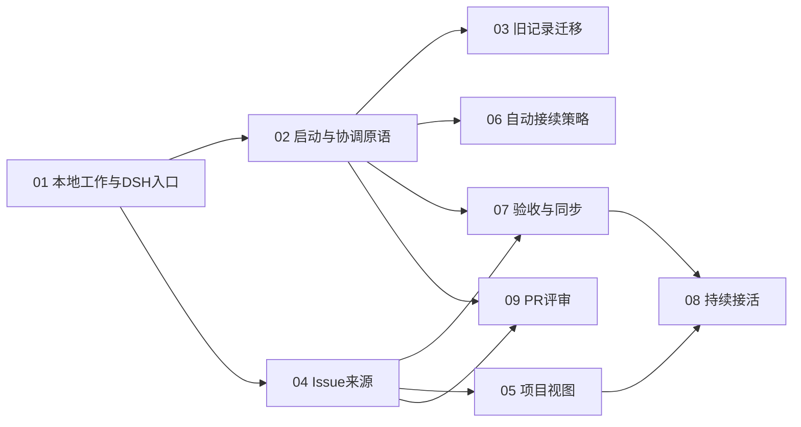

# A²D² v3 开发切片与发布计划

**状态：已确认、已发布并读回核验。** 主任务 [#120](https://github.com/a2d2-dev/dsh-plugin/issues/120)，9 个子任务 #121–#129。原生父子关系、11 条依赖边和标签均已核对；无需重新确认或再次建票。详情见[发布记录](publication-result.json)。

父规格：[DSH 内工作控制面板与连续执行](../a2d2-control-panel-v3.md)。实现从已核实开发代码及本规格文档建立隔离工作树；不能直接基于落后的 main 重写已有运行器，也不接管现有实例。

## 已发布切片

1. **[DSH 单入口、本地项目与工作详情](01-local-work-panel.md)** — 无前置。交付“创建本地工作 → 四标签详情 → 关联真实会话 → 从原生会话返回工作”的完整入口。
2. **[单项工作启动与协调](02-start-and-coordinate.md)** — 阻塞于 01。交付真实启动/复用、Task/Session 双向唯一协调、等待/恢复，以及新身份下的手动接续和恢复原语。
3. **[旧工作安全迁移](03-legacy-migration.md)** — 阻塞于 02。交付隔离旧记录的预览、稳定映射、安全接管、交接中恢复和防双写升级路径。
4. **[GitHub Issue 来源与唯一接入](04-issue-source.md)** — 阻塞于 01。交付具体项目的来源读取、分页、重复导入处理、完整内容保存与真实会话关联。
5. **[真实项目视图与对应内容](05-project-views.md)** — 阻塞于 04。交付真实 views/items、标签字段、搜索/分页及 Issue/PR/draft/受限条目的分流。
6. **[可配置上下文接续](06-context-continuation.md)** — 阻塞于 02。交付项目软阈值、可靠来源标记、明确退化行为、自动接续与可查询历史。
7. **[本地验收与可恢复外部关闭](07-completion-and-sync.md)** — 阻塞于 02、04。交付真实证据/标准结果入口、父子本地完成链、收口/父通知/outbox与独立补同步。
8. **[持久化持续接活](08-continuous-work.md)** — 阻塞于 05、07。交付具体来源范围的发现/去重/领取、等待安全让槽、恢复串行调度、暂停和接下一项。
9. **[PR 与真实评审会话](09-pr-review.md)** — 阻塞于 02、04。交付 PR 目录、无 Task PR 的显式关联、评审会话复用和独立结果记录；不阻塞持续接活。

初始 frontier 只有 01；之后 02 与 04 可各自推进。功能没有阻塞边不代表必须并行修改同一文件，实施可按冲突风险调度。03 是旧数据启用前的升级验收门槛；06 与 08 无领取算法依赖，但整体验收必须组合验证长程接活和接续。

## 测试接缝（LF 已确认）

- **主合同面**：统一工作应用的公开命令/查询，真实本地记录和 DSH 运行机制，模型与外部来源使用可控适配。
- **用户面**：真实隔离 DSH Web＋真实插件 bundle＋真实会话/Workspace，禁用意外模型调用；浏览器验收入口、详情、标签、会话往返和状态。
- **真实依赖补验**：目标 GitHub 来源只读权限/分页/视图对照；专用对象外部写验收；真实模型接续内容质量独立记录。

不以纯组件 mock 或原型成功代替宿主集成。只测试外部行为、数据和副作用，不为迁就实现添加镜像测试。

## 发布方式与执行状态

1. 已推送当前规格分支，保证原型、ADR、能力核查和票据正文的引用可由 tracker 访问；不合并到 main，不部署。
2. 已创建主任务 #120，正文采用父规格，标签 `a2d2:main`，不复用或修改旧 #70/#112。仓库约定要求主任务与实现子票标签区分，主任务不伪装成单张可直接实现工单。
3. 已按拓扑顺序创建 9 个子 Issue（#121–#129），标签 `ready-for-agent`，每票自包含并保留已确认原型/规格引用。
4. 已添加并读回验证原生 sub-issue 关系和 blocked_by 依赖；使用数字数据库 ID，不能把 issue number 或 node ID 当作它。
5. 已保存实际主/子 Issue URL 与依赖映射；不关闭旧工作项，不修改既有 parent 正文。
6. 下一阶段，每个实现票在新会话和隔离分支执行，按其 blocker 完成状态进入 frontier；包含 TDD、代码/规格双轴 review 和真实宿主证据。

[发布清单](publication-manifest.json)保存标题、正文来源、符号依赖和真实工单映射；[发布记录](publication-result.json)保存数据库 ID、实际原生关系和读回结果。远端正文已移除草案说明，并使用固定规格提交的链接。

## 已复核并收紧的点

- 等待让出的是自动推进槽位，Task owner/会话继续保留；结果进入后有序恢复。
- 新 TaskRef 的完整手动接续恢复归 02，所以 03 不需要隐含等待 06 才能迁移活动交接。
- token 估算可用于明示的软目标判断；缺关键元数据、路由变化及恢复行为有确定表格。
- 本地父子、拆解、进展、提问、证据和标准结果都有明确命令/工具归属，不依靠 fixture 私造输入。
- 项目视图和 PR 评审拆成 05/09，去除队列对 PR 的不必要依赖；普通 DSH 会话回工作详情被列为明确验收。

## GitHub 工单映射

| 切片 | 工单 | 原生阻塞项 |
| --- | --- | --- |
| 01 DSH 单入口、本地项目与工作详情 | [#121](https://github.com/a2d2-dev/dsh-plugin/issues/121) | 无 |
| 02 单项工作启动、当前协调会话与执行资格 | [#122](https://github.com/a2d2-dev/dsh-plugin/issues/122) | [#121](https://github.com/a2d2-dev/dsh-plugin/issues/121) |
| 03 旧工作记录安全迁移与恢复接管 | [#123](https://github.com/a2d2-dev/dsh-plugin/issues/123) | [#122](https://github.com/a2d2-dev/dsh-plugin/issues/122) |
| 04 GitHub Issue 来源、唯一接入与本地内容保留 | [#124](https://github.com/a2d2-dev/dsh-plugin/issues/124) | [#121](https://github.com/a2d2-dev/dsh-plugin/issues/121) |
| 05 当前项目的真实视图与对应内容 | [#125](https://github.com/a2d2-dev/dsh-plugin/issues/125) | [#124](https://github.com/a2d2-dev/dsh-plugin/issues/124) |
| 06 可配置上下文接续与历史会话观察 | [#126](https://github.com/a2d2-dev/dsh-plugin/issues/126) | [#122](https://github.com/a2d2-dev/dsh-plugin/issues/122) |
| 07 本地验收完成、父通知与可恢复外部关闭 | [#127](https://github.com/a2d2-dev/dsh-plugin/issues/127) | [#122](https://github.com/a2d2-dev/dsh-plugin/issues/122)、[#124](https://github.com/a2d2-dev/dsh-plugin/issues/124) |
| 08 持久化持续接活、串行领取与暂停恢复 | [#128](https://github.com/a2d2-dev/dsh-plugin/issues/128) | [#125](https://github.com/a2d2-dev/dsh-plugin/issues/125)、[#127](https://github.com/a2d2-dev/dsh-plugin/issues/127) |
| 09 PR 目录、工作关联与真实评审会话 | [#129](https://github.com/a2d2-dev/dsh-plugin/issues/129) | [#122](https://github.com/a2d2-dev/dsh-plugin/issues/122)、[#124](https://github.com/a2d2-dev/dsh-plugin/issues/124) |
